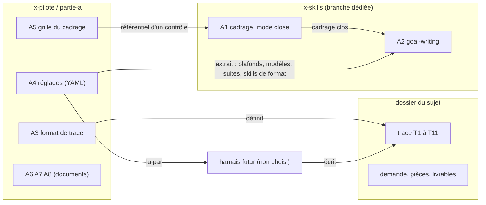

# A6 : architecture des pièces sans harnais (partie A)

Volet « architecture » de A6 (le volet « spec » est dans `partie-a/A6-spec.md`). Ce document décrit l'architecture des huit pièces A1 à A8 et de leurs interfaces : quelle étape lit quelle pièce, ce que chaque pièce attend et rend, ce qu'un harnais futur devra lire et écrire. **L'architecture du harnais lui-même est exclue** (LR1 du cadrage clos) : le harnais n'est pas choisi (D1, D14), et aucune pièce n'en suppose un (C1).

**Étiquettes.** Chaque affirmation de conception porte une étiquette : **[confirmé]** (donné par le cadrage clos ou lisible dans une pièce), **[hypothèse]** (suppose une échelle ou un usage), **[ouvert]** (à décider, avec qui). Les sigles D, C, LR, RA renvoient à `trace/01e-cadrage-clos.md`. Aucune valeur de réglage n'est écrite ici : le document renvoie à la clé de `partie-a/A4-reglages.yaml`.

**Pièces lues pour ce document.** Seulement : le cadrage clos, la procédure, les skills `cadrage` (mode `close`) et `goal-writing`, A3, A4, A5, A7 (guide et « lire une trace »), A8, et le format `system-design`. Non ouverts, bien que cités par ces pièces : `ix-skills/CLAUDE.md`, les `README.md`, `skills/controle-qualite.md`, `criteres-reussite`, `brief-client.md`, `trace/journal.md`, `corpus/ix-recipes/executeur.md`. Les affirmations sur ces fichiers viennent de ce que les pièces lues en disent.

---

## 1. Résumé

- **Architecture recommandée.** Huit pièces en deux dépôts, couplées uniquement par des **contrats de fichier** : un fichier de réglages (A4) que tout lit, un format de trace (A3) que tout écrit, un référentiel (A5) que le contrôle de cadrage applique, et deux skills (A1, A2) qui se passent un document (le cadrage clos). Aucune pièce n'appelle une autre ; c'est le pilote, ou plus tard un harnais, qui les enchaîne.
- **Charge sur laquelle elle repose.** Un pilote, un sujet à la fois, un passage de plusieurs heures, quelques dizaines de lignes par table de trace, un seul rédacteur à la fois (section 3). Rien ne justifie de base de données, de service ni de verrou.
- **Hypothèse la plus risquée.** Que des formats neutres (Markdown, YAML) conviendront au harnais choisi en B (RA1), et que « fin du jugement », qui borne le gel et le scellé, a un sens unique (section 12, Q1).
- **Décisions demandées.** Définir « fin du jugement » (Q1) et dire qui associe un livrable à un skill de format (Q2). Les autres écarts relevés pendant la rédaction ont été corrigés dans les pièces (section 15).

---

## 2. Exigences

### 2.1 Fonctionnelles

| # | Exigence | Étiquette | Source |
|---|---|---|---|
| F1 | Chaque étape (0 à 7) laisse une ligne de trace : entrée, sortie, modèle, durée, jetons, coût avec sa source, skills avec version et empreinte, version des réglages | confirmé | C3, C4, C5, A3 |
| F2 | Les réglages tiennent en un seul fichier documenté ; les autres pièces renvoient à la clé, sans recopier la valeur | confirmé | C8, D7, A4 (en-tête), A8 §2 |
| F3 | Le cadrage clos se produit par un mode de `cadrage` choisi par le message, sans changer le comportement par défaut | confirmé | C10, `cadrage` §Modes |
| F4 | Un goal se rédige à partir du cadrage clos et des réglages, sans voir les critères ni la part cachée | confirmé | A2 (règle absolue), D5 |
| F5 | Un cadrage se juge point par point (G1 à G9) avec une grille valable pour tous les sujets, en deux moments | confirmé | A5 |
| F6 | À tout plafond atteint : arrêt, échec tracé, main rendue, suites proposées parmi celles des réglages, choix tracé | confirmé | D8, LR4, A4 `suites_au_plafond`, A3 T7 |
| F7 | La part cachée et la trace du juge restent hors de portée du producteur jusqu'à la fin du jugement ; le script de recette et la grille visible sont figés avant la production | confirmé | D5, C6, A4 `gel`, A3 T9 |
| F8 | Un lecteur sans Claude Code lit la trace de son sujet, et de lui seul | confirmé | D13, C7, LR2 |

### 2.2 Non fonctionnelles

| # | Exigence | Étiquette | Source |
|---|---|---|---|
| N1 | Aucune pièce ne suppose un harnais ; elle peut nommer ce qu'un harnais devra faire, jamais comment | confirmé | C1 |
| N2 | Reproductibilité = même déroulé (étapes, entrées, modèles, skills avec version et empreinte, plafonds), pas même livrable | confirmé | D4, RA3 |
| N3 | Aucun skill d'ix-skills ne nomme un skill d'ix-recipes | confirmé | C9 |
| N4 | Une trace par sujet, dans son dossier ; aucune copie de pièce hors de ce dossier ; aucun renvoi à une pièce d'un autre sujet | confirmé | C7, A3 §1 |
| N5 | Un coût porte toujours sa source (mesuré, estimé, n.c.) ; une estimation ne se présente jamais comme une mesure | confirmé | C4, A3 §4 |
| N6 | Lisible par un humain sans outil (Markdown), exploitable par un programme sans heuristique (titres fixes, colonnes nommées) | confirmé | A3 §6, LR2 |
| N7 | Pièces en français, sauf le corps des skills d'ix-skills (anglais) | confirmé | RA10, C11 |
| N8 | Modèle explicite sur chaque appel d'agent ; Fable seulement après accord, en appel à part | confirmé | C13, A4 `production.modele_explicite_obligatoire` et `modeles.contre_verification` |

### 2.3 Contraintes de contexte

- Un seul utilisateur au départ (Amiel, pilote et mainteneur) **[confirmé]** (D2, B3). Le client est un lecteur (LR2).
- Deux dépôts, ix-skills sur une branche dédiée, non fusionnée dans `main` (LR6, C12) **[confirmé]**.
- Seul le type de sujet « code » est rempli ; les trois autres sont marqués « partie C » **[confirmé]** (C2, D3, A4 `types_de_sujet`).

### 2.4 Données personnelles

Les pièces d'un client peuvent contenir des données personnelles ; les pièces de la partie A n'en contiennent pas. Voir la section 10 (**à qualifier**, question Q5).

---

## 3. Estimation de charge

Écrite avant tout choix d'architecture, comme le format l'exige.

| Quantité | Calcul | Étiquette |
|---|---|---|
| Utilisateurs | 1 pilote, 1 sujet à la fois | confirmé (D2) |
| Durée active d'un passage | plusieurs heures, dont l'attente humaine est la plus grosse part (`01c` §2, cité par le cadrage clos §2) ; on retient 4 heures pour le calcul | hypothèse |
| Lignes de T3 | étape 0, 1a à 1e avec leurs passes, 2A et 2B avec leurs passes, 3, 4, 5, 6, 7 : de l'ordre de 15 à 30 lignes ; les passes sont bornées par `plafonds.passes_verification_max`, les tours de correction par `plafonds.tours_correction_max` | hypothèse |
| Lignes de T4 et T5 | 1 à 3 skills par ligne de T3, quelques sous-agents par session ou jugement : de l'ordre de 30 à 60 lignes de T4, quelques dizaines de T5 | hypothèse |
| Lignes de T10 | une par lancement du script pendant la production et la correction ; borné par le nombre de tours (`plafonds.tours_goal_max`, `plafonds.tours_correction_max`) : quelques dizaines | hypothèse |
| Taux d'écriture moyen | environ 30 lignes de T3 sur 4 heures, soit une écriture toutes les 8 minutes | hypothèse |
| Facteur de pointe | ×5, deviné : pendant la production, une ligne de T10 peut suivre chaque tour | hypothèse |
| Taux de pointe | une écriture toutes les 1 à 2 minutes | hypothèse |
| Concurrence en écriture | nulle : l'écriture de la trace se fait par un seul rédacteur à la fois, comme celle des livrables (A2, autorisations) | confirmé (A2 §4, procédure étape 4) |
| Volume de la trace | quelques centaines de lignes de tableau au plus | hypothèse |
| Coût à l'usage | la trace n'engendre aucun appel facturé. Le coût d'architecture est la lecture des pièces dans le contexte des agents : un agent qui reçoit A3 entier paie ce contexte à chaque tour. Chiffrage non fait : la taille en jetons n'est pas mesurée | hypothèse |

**Conclusion.** À cette échelle, des fichiers texte versionnés suffisent. Une base, un service ou un verrou de concurrence ne se justifient ni par la charge ni par une exigence (équipes séparées, composant réglementé). Aucun n'est ajouté.

---

## 4. Composants

### 4.1 Les huit pièces

| Pièce | Rôle | Nature | Dépôt | Fichier (A8 §1) | Propriétaire |
|---|---|---|---|---|---|
| **A1** | Clore un cadrage : prend un cadrage soumis et les réponses de la pause, rend un cadrage clos en douze sections | skill (mode `close` de `cadrage`, version mineure) | ix-skills, branche `claude/pieces-sans-harnais-partie-a` (nom donné par A8, non vérifié ailleurs) | `skills/cadrage.md` | Amiel |
| **A2** | Rédiger le goal d'un agent autonome | skill (nouvel atome `goal-writing`) | ix-skills, même branche | `skills/goal-writing.md` | Amiel |
| **A3** | Dire comment on tient la trace d'un sujet | format de document (onze tables T1 à T11) | ix-pilote | `partie-a/A3-format-trace.md` | Amiel |
| **A4** | Porter toutes les valeurs de réglage et l'association type de sujet vers skills de format | fichier de réglages (YAML) | ix-pilote | `partie-a/A4-reglages.yaml` | Amiel |
| **A5** | Référentiel de jugement du cadrage (G1 à G9) | grille, avec en-tête d'application | ix-pilote | `partie-a/A5-grille-cadrage.md` | Amiel |
| **A6** | Cette architecture, avec la spec | document de conception | ix-pilote | `partie-a/A6-architecture.md` (+ `A6-spec.md`) | Amiel |
| **A7** | Guide d'usage et « lire une trace » | documents (le second se lit seul) | ix-pilote | `partie-a/A7-guide-usage.md`, `partie-a/A7-lire-une-trace.md` | Amiel |
| **A8** | Note de maintenance | document | ix-pilote | `partie-a/A8-maintenance.md` | Amiel |

Hors des huit pièces : le **dossier du sujet** (demande, pièces, livrables, trace) et le **harnais futur** (non choisi). Les skills de format d'ix-recipes ne sont pas des pièces : on les lit, on n'y écrit pas (A8 §1).

### 4.2 Diagramme (un seul, pour la décision de placement)

Le couplage est unidirectionnel : les skills (ix-skills) ne dépendent d'aucun fichier d'ix-pilote ; c'est le message qui leur apporte A5 et l'extrait d'A4. Ce n'est donc pas une dépendance du skill, c'est une entrée.

---

## 5. Flux : étape par pièce

« lit » et « écrit » sont du point de vue de l'étape. Les modèles et plafonds sont ceux des clés citées, jamais recopiés. Les pauses (étape `pause 1`, `pause 2`) et le gel (étape `3`, occurrence `gel`) sont des lignes de T3 faites par le pilote ; leurs décisions et leurs empreintes vont en T6 et T9.

| Étape | Qui | A1 (`close`) | A2 | A3 (trace) | A4 (réglages) | A5 (grille) |
|---|---|---|---|---|---|---|
| **0 Brief** | pilote | n'y touche pas | n'y touche pas | **écrit** T1, T2 et la première ligne de T3 (demande séparée des pièces) | **lit** `version`, empreinte du fichier, `plafonds.*` (copiés dans T2), clé du type dans `types_de_sujet` | n'y touche pas |
| **1a Cadrer** | agent, rôle `modeles.cadrage_et_criteres` | mode par défaut de `cadrage` (pas `close`) | n'y touche pas | **écrit** T3 (appel), T4 | **lit** `modeles.cadrage_et_criteres` | n'y touche pas |
| **1b Questionner** | idem (en parallèle de 1a) | n'y touche pas | n'y touche pas | **écrit** T3, T4 | **lit** `modeles.cadrage_et_criteres` | n'y touche pas |
| **1c Taille** | idem | n'y touche pas | n'y touche pas | **écrit** T3, T4 ; T8 si le sujet est découpé | **lit** `modeles.cadrage_et_criteres`, `sujets_enfants.geres_par_la_procedure` | G8 reprend les quatre tests |
| **1d Évaluation** | agent distinct de l'auteur, rôle `modeles.evaluation_cadrage` | n'y touche pas | n'y touche pas | **écrit** T3 (une ligne par passe), T4, T2 (`atteint`), T7 si plafond | **lit** `modeles.evaluation_cadrage`, `plafonds.passes_verification_max`, `suites_au_plafond.passes_verification` | **lit** comme référentiel : G1, G2, G4 à G8 ; G3 et G9 notés « attente de la pause 1 », sans verdict |
| **Pause 1** | pilote | n'y touche pas | n'y touche pas | **écrit** T6 (réponse ou défaut accepté, `à rappeler`) | n'y touche pas | n'y touche pas |
| **1e Clôture** | agent, rôle `modeles.cadrage_et_criteres` | **applique** `close` : lit le cadrage soumis, les réponses (T6), A5 ; rend le cadrage clos | n'y touche pas | **écrit** T3, T4 (le mode choisi par le message va en `note`) | **lit** `modeles.cadrage_et_criteres` | **lit** les neuf points pour écrire en les tenant ; un agent distinct les applique ensuite au cadrage clos |
| **2A Goal** | rédacteur (`modeles.redaction_goal`), puis vérificateur (`modeles.verification_goal`) | **lit** sa sortie : le cadrage clos | **applique** | **écrit** T3 (une ligne par passe), T4, T2, T7 si plafond | **lit** `plafonds.tours_goal_max`, `production.sous_agents_niveaux_max`, `production.sous_agents_parallele_max`, `production.modele_explicite_obligatoire`, les `modeles` des rôles de sous-agents, `suites_au_plafond.tours_goal`, `gel.*`, `types_de_sujet.<type>.skills_de_format` | **ne lit pas** les critères |
| **2B Critères** | rédacteur (`modeles.cadrage_et_criteres`), puis contre-vérificateur (`modeles.contre_verification`, après accord) | **lit** sa sortie : le cadrage clos | **ne voit pas** le goal | **écrit** T3, T4 ; la part cachée est produite et sera scellée (T9) | **lit** `types_de_sujet.<type>.annexes_criteres`, `modeles.contre_verification`, `plafonds.passes_verification_max` | n'y touche pas |
| **3 Réconciliation** | agent, rôle `modeles.reconciliation` | **lit** le cadrage clos | **lit** le goal rendu | **écrit** T3, T4 | **lit** `modeles.reconciliation` | n'y touche pas |
| **Pause 2 puis Gel** | pilote | n'y touche pas | n'y touche pas | **écrit** T6 ; **T9** : script, grille visible, fixtures à `figé` avec empreinte ; part cachée à `scellé`, emplacement `non écrit` | **lit** `gel.script_et_grille_figes`, `gel.gele_jusqu_a`, `gel.part_cachee_scellee_jusqu_a` | n'y touche pas |
| **4 Production** | producteur, rôle `modeles.production` ; sous-agents (`modeles.sous_agents_lecture`) | n'y touche pas | n'y touche pas (le producteur lit le goal que A2 a rendu) | **écrit** T3 (granularité `session`), T4, T5, T10, T7 si plafond ; **lit** T9 pour comparer les empreintes | **lit** `production.*` ; plafond de tours déjà porté par le goal | n'y touche pas |
| **5 Jugement** | juge distinct, contexte neuf (`modeles.juge`) ; sous-agents (`modeles.verification_mecanique`, `modeles.nouveau_venu`) | n'y touche pas | n'y touche pas | **écrit** T3 (granularité `étape`, `sortie` = « scellé, voir T9 »), T4, T5 ; la trace du juge est tenue scellée (T9) | **lit** `modeles.juge`, `modeles.verification_mecanique`, `modeles.nouveau_venu` | n'y touche pas |
| **6 Correction** | producteur, même session | n'y touche pas | n'y touche pas | **écrit** T3 (session), T10, T7 si plafond | **lit** `plafonds.tours_correction_max`, `suites_au_plafond.tours_correction` | n'y touche pas |
| **Fin du jugement** | pilote | n'y touche pas | n'y touche pas | **écrit** T9 : part cachée et trace du juge passent à `ouvert`, emplacement écrit, `ouvert_à` rempli | n'y touche pas | n'y touche pas |
| **7 Livraison, terrain** | pilote | n'y touche pas | n'y touche pas | peut **écrire** une ligne de T3 (`étape` 7), faite par une personne : granularité `appel` | n'y touche pas | n'y touche pas |
| **Relecture d'A5** (hors étapes) | contre-vérificateur, après accord | n'y touche pas | n'y touche pas | l'état de la relecture est porté par une ligne de T3 d'étape `1d`, occurrence `relecture de la grille` | **lit** `modeles.contre_verification` | **lit** pour la relire, une fois, entre la production et le juge |

**Documents (A6, A7, A8).** Aucune étape ne les lit comme entrée de travail. A7 est lu par le pilote ou le client ; A8 par le mainteneur ; A6 par le constructeur de B.

---

## 6. Contrats d'interface, pièce à pièce

### 6.1 A4 : ce qu'il expose, et qui le lit

A4 est le seul endroit où une valeur de réglage est écrite. Il se charge par un programme (YAML, `yaml.safe_load`) ; la clé `version` est à la racine. Les autres pièces citent la clé.

| Groupe de clés | Ce qu'il règle | Lecteurs |
|---|---|---|
| `version` | version du fichier (règle de montée : majeure, mineure, correctif) | étape 0 (T1, `version_réglages`), toute ligne de T3 (`réglages`) |
| `plafonds.passes_verification_max`, `plafonds.tours_correction_max`, `plafonds.tours_goal_max` | les trois plafonds | étape 0 (copie en T2) ; 1d, 2A, 2B (passes) ; A2 (tours du goal, copié dans le goal) ; étape 6 (correction) |
| `production.mode`, `production.sous_agents_niveaux_max`, `production.sous_agents_parallele_max`, `production.modele_explicite_obligatoire` | mode et limites de la session de production | A2 (limites des sous-agents, modèle explicite) ; le harnais ou le pilote qui lance la production |
| `gel.script_et_grille_figes`, `gel.gele_jusqu_a`, `gel.part_cachee_scellee_jusqu_a` | quoi figer, quoi sceller, jusqu'à quand | A2 (clause d'intégrité des fichiers figés) ; le gel à l'étape 3 ; la fin du jugement |
| `modeles.*` | le modèle de chaque rôle ; `modeles.contre_verification` porte deux valeurs et la personne à qui demander l'accord | tout appel d'agent (une clé par rôle, voir la section 5) ; A2 pour les sous-agents |
| `suites_au_plafond.passes_verification`, `suites_au_plafond.tours_correction`, `suites_au_plafond.tours_goal` | les suites offertes à chaque plafond | A2 (liste, sans choisir) ; le pilote ; T7 (`suites_proposées`) |
| `definition_des_suites` | libellé de chaque suite | A7, A3 (T7, `suite_choisie`) |
| `sujets_enfants.geres_par_la_procedure` | pas de sujets enfants gérés | étape 1c ; T8 |
| `types_de_sujet.<type>.skills_de_format`, `.skills_facultatifs`, `.annexes_criteres` | l'association type de sujet vers skills de format et annexe de critères | le pilote ou le harnais, qui fournit à A2 la liste des skills de format ; 2B pour l'annexe |
| `types_de_sujet.<type>.statut` | marque « partie C » : type non rempli | étape 0 (refus de démarrer, obligation O1) |

**Règles du contrat.** Une valeur n'est écrite qu'ici. Un changement monte `version` (A8 §2). Un goal déjà rédigé garde la valeur qu'il porte (A8 §2) : voir le risque R3.

### 6.2 A3 : ce qu'il exige de qui l'écrit

A3 est un contrat de forme : les noms de tables (T1 à T11) et de colonnes sont fixes ; l'ordre des colonnes est libre.

| Exigence | Source |
|---|---|
| Une trace par sujet, dans le dossier du sujet ; en un fichier, ou en extraits qui suivent les mêmes titres et colonnes | A3 §1 règle 1 |
| Aucune copie de pièce hors du dossier ; chemins relatifs au dossier du sujet ; aucun renvoi à un autre sujet, sauf T8 qui nomme le dossier de l'enfant sans citer de pièce | A3 §1 règles 2 et 3 |
| Un champ par colonne ; aucune cellule vide : `n.c.`, `inclus dans la session` ou `sans objet`, avec la raison en `note` ou `méthode_coût` | A3 §2 |
| La première ligne de T3 est l'étape 0 ; `ligne` unique dans la trace | A3 §4 |
| Granularité par étape : `appel` (0 à 3), `session` (4 et 6), `étape` (5) ; sous-agents en T5 avec leur modèle, sans coût individuel | A3 §3, §4 T5 |
| Coût : `mesuré`, `estimé` (avec `méthode_coût` obligatoire qui dit ce qu'elle ignore) ou `n.c.` ; jamais d'estimation présentée comme mesure | A3 §4 |
| T4 : version et empreinte sha256 du texte du skill tel que lu à l'appel, ou `n.c.` avec la raison | A3 §4 T4 |
| T2 : la valeur de chaque plafond (et limite numérique de la production) lue dans A4 au lancement ; `atteint = oui` renvoie à T7 | A3 §4 T2 |
| T9 : un élément `scellé` n'a pas d'emplacement écrit (`non écrit`), seulement son empreinte ; la ligne de T3 du juge porte « scellé, voir T9 » en `sortie` | A3 §4 T9 |
| T10 : le nombre de vérifications (`vérifications`) ne baisse jamais d'un lancement à l'autre | A3 §4 T10 |

**Lecture par programme (A3 §6).** Titre de niveau 3 commençant par « T3 », ligne d'en-tête = noms de colonnes, sélection par `étape` et `occurrence` ou par `ligne`, jointure de T4 et T5 sur `ligne`. Cette lecture est un contrat de forme : un harnais qui écrit autrement ne le tient pas.

### 6.3 A5 : référentiel d'un contrôle en mode verdict

| Élément | Contrat |
|---|---|
| Rôle dans le contrôle | A5 est le **référentiel** ; le cadrage est le **livrable** ; G1 à G9 sont les suspicions (A5, en-tête). Les noms de paramètres `reference`, `deliverable`, `suspected` sont ceux du skill `controle-qualite` (champs `reference`, `deliverable`, `mode`, `suspected`) |
| Entrée | A5 en entier, le cadrage, et pour chaque point à juger le passage exact qui porte la règle |
| Sortie | un verdict **par point** : `breach`, `compliant`, `doubtful`, `not found`, `outside reference` ; jamais un verdict sur le cadrage en bloc. Dans chaque verdict, le juge sépare « attente de la pause 1 » et « défaut corrigeable » |
| Moments | avant la pause 1 : G1, G2, G4 à G8 ; G3 et G9 ne s'appliquent pas. Après la pause 1 : les neuf, par un agent distinct de l'auteur |
| Borne | le nombre de passes avant la pause est `plafonds.passes_verification_max` |
| Correspondance A5 vers A1 | chaque point a sa section dans la sortie d'A1 (tableau ci-dessous) ; un script de recette le vérifie (cadrage clos §10) |
| Relecture | une fois, par `modeles.contre_verification`, après accord |

**Correspondance G vers sections de la sortie `close`** (ordre et mots du skill) :

| Point d'A5 | Section de la sortie d'A1 |
|---|---|
| G1 intention | 1. Intention |
| G2 public et situation | 2. Audience and situation of use |
| G3 aucune question bloquante | 3. Decisions ; 12. Residual question |
| G4 hors-périmètre | 5. Scope (partie « out of scope ») |
| G5 contrainte et raison | 4. Constraints, with their rationale |
| G6 hypothèses en risques acceptés | 8. Remaining assumptions, as accepted risks |
| G7 livrables, lecteur, doc, spec et architecture | 7. Deliverables |
| G8 tests de découpage | 9. Splitting tests replayed |
| G9 goal et critères dérivables | 10. Ready for the next step |

### 6.4 A1 : entrées et sorties (mode `close`)

| | Contenu |
|---|---|
| **Déclenchement** | le message demande de clore un cadrage (ex. « mode close ») **et** fournit le cadrage soumis et les réponses. Sans cela, le skill reste en mode par défaut et ne passe jamais en `close` de lui-même |
| **Entrées requises** | le cadrage soumis (avec ses questions bloquantes et leur défaut) ; les réponses de la pause (mots du décideur si disponibles) |
| **Entrées facultatives** | demande d'origine et sources citées (pour vérifier un fait, jamais pour rouvrir une décision) ; une grille de référence (A5) ; d'autres tests de découpage |
| **Règles de clôture** | une réponse l'emporte sur le défaut ; un défaut accepté sans remarque est marqué comme tel et rappelé au décideur ; une question bloquante sans réponse devient la question résiduelle |
| **Sortie** | un cadrage clos : l'entête (entrées utilisées, règle de priorité) puis douze sections dans un ordre fixe, toutes non vides ou dites sans objet |
| **Interdits** | rouvrir une décision ; ajouter une décision que les réponses ne soutiennent pas ; nommer un outil ou un skill comme producteur d'un livrable (C9) |
| **Cas d'erreur** | question bloquante sans réponse et sans défaut : la décision la moins engageante, marquée « à confirmer » ; le document dit alors s'il est prêt ou non |

### 6.5 A2 : entrées et sorties

| | Contenu |
|---|---|
| **Entrées requises** | le cadrage clos ; les réglages (plafond de tours, modèle de chaque rôle, limites des sous-agents, suites offertes, gel du script et de la grille) ; pour chaque livrable, son skill de format et l'instruction donnée |
| **Entrée facultative** | les noms des valeurs fixées plus tard (chemin du script de recette, fichier d'empreintes, dossier des pièces, branche) |
| **Non-entrées** | critères de réussite, grille, tout ce qui est scellé ; si le message en fournit, le skill les ignore et le dit dans ses notes |
| **Sortie** | un goal en markdown (`status: draft`) : valeurs fixées plus tard, intention, livrables, contraintes et interdits, autorisations, condition d'arrêt, plafond de tours, conduite au plafond, ce qu'on trace ; suivi des notes du rédacteur (hors goal) |
| **Garanties** | la condition d'arrêt renvoie au script de recette par son emplacement nommé, sans dire ce qu'il vérifie ; l'interdiction de modifier script et grille est écrite ; chaque appel de sous-agent a un modèle explicite pris dans les réglages ; l'écriture des livrables reste sur le fil principal ; le plafond est celui des réglages |
| **Cas d'erreur** | un emplacement nommé non rempli au démarrage : l'agent ne produit rien, écrit la raison dans son message final et rend la main ; un trou du cadrage : option la moins engageante, marquée « à confirmer » et listée à part |

### 6.6 Chaîne entre pièces (qui passe quoi à qui)

| De | Vers | Objet passé | Passé par |
|---|---|---|---|
| A5 | A1 | grille de référence | le message du pilote ou du harnais |
| A1 (sortie) | A2 | cadrage clos | idem |
| A4 (extrait) | A2 | plafond de tours, modèles par rôle, limites de sous-agents, suites, indicateur de gel | idem |
| A4 (association) | A2 | liste des skills de format par livrable | idem ; le calcul de cette liste n'est écrit dans aucune pièce (Q2) |
| A4 | A3 | `version`, empreinte du fichier, plafonds au lancement | l'étape 0 |
| A2 (goal) | producteur | la mission, avec ses emplacements nommés remplis | idem |
| A3 | tous | format de la trace | chaque étape qui écrit une ligne |

---

## 7. Où vit l'association type de sujet vers skills de format

- **Dans A4 seulement**, sous `types_de_sujet.<type>` : les clés `skills_de_format` (un skill par sorte de livrable : la spécification, l'architecture, la documentation), `skills_facultatifs` et `annexes_criteres` **[confirmé]** (C9, A4 en commentaire de `skills_de_format`).
- **Aucun skill d'ix-skills ne la porte** : à la lecture, ni le corps d'A1 ni celui d'A2 ne nomme un skill d'ix-recipes. A2 reçoit les skills de format **en entrée** ; A1 prévoit un livrable spec et architecture sans dire quel skill le produit **[confirmé par lecture]**.
- **A6 (ce document) et A8 décrivent l'association et renvoient à la clé** ; ils n'en recopient pas l'identifiant comme valeur (A8 §3 étape 3). Changer l'association = éditer A4 et monter `version`.
- **Le passage de la clé au livrable** (quel livrable du sujet correspond à quelle clé de `skills_de_format`, et qui le calcule) n'est écrit nulle part : A4 est indexé par sorte de livrable, le cadrage clos par livrable de la partie A (A1 à A8). **[ouvert]**, Q2.
- **Types non remplis.** `reponse_commerciale`, `audit_ux` et `formation` portent `statut` (« partie C ») et aucune des trois clés. Un lecteur d'A4 qui cherche leurs `skills_de_format` ne les trouve pas : le harnais doit s'arrêter avant de démarrer (obligation O1), pas deviner.

---

## 8. Stockage

Aucune base. Tout est fichier texte, versionné par git.

### 8.1 Où vit quoi

| Lieu | Contenu | Règle |
|---|---|---|
| ix-skills, branche dédiée | `skills/cadrage.md`, `skills/goal-writing.md` et leurs `.mystaffy.json`, `dist/skills/<id>/`, `CHANGELOG.md`, `README.md`, `README-fr.md`, `dist/.claude-plugin/plugin.json` | non fusionnée dans `main` (LR6) ; publication par les étapes d'A8 §4 |
| ix-pilote, `partie-a/` | A3 à A8 ; essais dans `partie-a/essais/` | hors de `trace/` et de `corpus/` (README d'ix-pilote, cité par le cadrage clos §7) |
| **Un seul fichier de réglages** | `partie-a/A4-reglages.yaml` | une valeur de réglage ne s'écrit qu'ici |
| Dossier du sujet | demande et pièces (rangées séparément), livrables, **une trace** (un fichier, ou des extraits par phase) | rien ne sort de ce dossier ; chemins relatifs |
| Hors du dossier lu par le producteur | part cachée et trace du juge, tant qu'elles sont `scellées` | leur emplacement est fixé à l'étape 3 (cadrage clos §10) ; il n'est pas écrit dans la trace, ni porté par A4 (Q3) |

### 8.2 `modele_donnees`

| Entité | Attributs clés | Relations | Règles |
|---|---|---|---|
| Réglages (A4) | `version`, groupes de clés de la section 6.1 | lu par T1 (`version_réglages`, `empreinte_réglages`), T2 (`plafond` = clé de `plafonds`), T7 (`plafond`, `suites_proposées`) | fichier unique ; version montée à chaque changement |
| Trace | T1 à T11 | une par sujet ; T1 une ligne | dans le dossier du sujet ; pas de cellule vide |
| T1 Sujet | `sujet`, `type_de_sujet`, `pilote`, `début`, `version_réglages`, `empreinte_réglages`, `sujet_parent` | `type_de_sujet` = clé de `types_de_sujet` ; `sujet_parent` = dossier ou `sans objet` | une seule ligne |
| T2 Plafonds appliqués | `plafond`, `valeur_appliquée`, `atteint` | une ligne par clé de `plafonds` et par limite numérique de la production | la valeur est copiée au lancement et ne suit pas les changements d'A4 |
| T3 Étapes | `ligne`, `étape`, `occurrence`, `granularité`, `entrée`, `sortie`, `agent`, `modèle`, `réglages`, `durée`, `jetons`, `portée_jetons`, `coût`, `source_coût`, `méthode_coût`, `note` | cible de `ligne` pour T4, T5, T7, T9, T10 | `ligne` unique ; première ligne = étape 0 ; ordre chronologique |
| T4 Skills | `ligne`, `skill`, `version`, `empreinte_sha256`, `fichier`, `note` | N par ligne de T3 | empreinte du texte tel que lu à l'appel |
| T5 Sous-agents | `ligne`, `rôle`, `modèle`, `objet`, `résultat` | N par ligne de T3 (session ou étape) | pas de coût individuel |
| T6 Pauses et décisions | `pause`, `question`, `décision`, `source`, `décideur`, `date`, `à rappeler` | alimente A1 (réponses) | `source` ∈ {réponse, défaut accepté, confirmé en bloc} ; `à rappeler = oui` pour un silence |
| T7 Plafonds atteints | `ligne`, `plafond`, `constat`, `suites_proposées`, `suite_choisie`, `tours_ajoutés`, `dérogation`, `réserve`, `décideur`, `date` | `plafond` = clé de `plafonds` ; `suites_proposées` ⊂ `suites_au_plafond.<plafond>` | aucun plafond atteint : phrase « aucun plafond atteint », pas de tableau |
| T8 Sujets enfants | `enfant`, `dossier`, `ligne`, `motif` | renvoi seulement | aucune pièce de l'enfant citée |
| T9 Gel et scellés | `élément`, `état`, `empreinte_sha256`, `emplacement`, `ligne`, `ouvert_à` | `ligne` vers T3 | `emplacement` = `non écrit` tant que `scellé` ; `ouvert_à` = `à venir` tant que scellé |
| T10 Lancements du script | `ligne`, `tour`, `commande`, `code_sortie`, `vérifications`, `échecs`, `durée_relevée`, `jetons_relevés` | `ligne` vers T3 (session) | le nombre de vérifications ne baisse jamais |
| T11 Points à confirmer et écarts | `ligne`, `nature`, `description`, `raison`, `confirmé_par` | `ligne` vers T3 | « aucun point à confirmer » si vide |
| Cadrage clos (sortie d'A1) | douze sections, dont décisions avec source et question résiduelle | entrée d'A2 ; jugé par A5 | chaque décision a sa source |
| Goal (sortie d'A2) | sections de la section 6.5 | lu par le producteur | plafond = valeur de `plafonds.tours_goal_max` au moment de la rédaction |

---

## 9. Compromis

| Décision | Plus facile | Plus difficile | À revoir, et au déclencheur |
|---|---|---|---|
| **Formats neutres (Markdown, YAML) plutôt que le format d'un harnais** | Aucune dépendance (C1) ; un client lit sans Claude Code (LR2) ; le harnais de B se choisit sans contrainte | Un harnais qui impose sa forme de trace ou de réglages obligera à traduire A3 et A4 (RA1) ; pas de validation de schéma ; les tableaux Markdown se lisent par titre et en-tête, ce qui est fragile si une cellule contient `\|` ou une liste séparée par `;` | Au choix du harnais en B ; ou si l'écriture de la trace par programme produit des lectures fausses |
| **Un seul fichier de réglages plutôt que des réglages éclatés par pièce** | Un plafond ou un modèle se change à un seul endroit (A8 §2) ; une seule `version` à consigner ; les pièces renvoient par la clé | Toute modification monte la version de l'ensemble ; un réglage propre à un outil (`production.mode`) cohabite avec des réglages neutres (tension avec C1, écart 6) ; le fichier grossit avec chaque type de sujet ; une erreur de syntaxe bloque tout | Quand un type de la partie C est rempli, ou quand un type a besoin de plafonds qui lui sont propres ; ou si le harnais charge ses réglages ailleurs |
| **Trace Markdown plutôt que trace structurée (JSON, base)** | Lisible sans outil ; auditable à l'œil ; suit l'édition humaine à la main (passage sans harnais) | Pas de types, pas de contrainte d'unicité de `ligne` hors convention ; la règle « jamais de cellule vide » ne tient que par discipline ; une réserve en texte long tient mal dans une cellule | Quand un harnais écrit la trace en concurrence, ou quand le volume dépasse la lecture à l'œil (au-delà de quelques centaines de lignes par table) |
| **Deux dépôts (ix-skills sur branche, ix-pilote)** | Respect de la règle de dépendance (C9) ; les skills servent tous les utilisateurs d'ix-skills avec leur processus de publication ; les pièces de procédure restent avec le dossier du sujet | Des pièces qui doivent rester cohérentes sans lien mécanique : A5 et les sections d'A1, A2 et les clés d'A4, A4 et A3 ; la version de la branche n'est pas celle du dossier ; deux acceptations (RA5) | Quand B retient un dépôt existant (A8 §5) : les pièces d'ix-pilote y migrent |
| **L'association type vers skills de format dans A4, jamais dans un skill** | C9 respecté ; une seule édition pour changer un skill de format (A8 §3) | A2 dépend de quelqu'un qui calcule la liste des skills de format par livrable (Q2) ; A4 est indexé par sorte de livrable et non par livrable | Au remplissage des types de la partie C |
| **A5 passée en entrée d'A1 plutôt qu'intégrée au skill** | Le skill ne dépend d'aucun fichier extérieur ; la grille évolue sans publier de version d'ix-skills | Rien dans le skill ne garantit que A5 est fournie ; la tenue de la grille repose sur le message et sur un script de recette | Si A5 se stabilise et devient générique : reconsidérer son entrée dans ix-skills |
| **Scellé par absence de chemin et empreinte seule** | La trace que lit le producteur n'apprend pas où est la part cachée ; la preuve d'intégrité reste | L'emplacement vit hors de toute pièce (Q3) ; sans lui, l'empreinte ne se vérifie pas ; la réouverture dépend du pilote | Quand B choisit un harnais qui sait tenir un espace hors de portée |
| **Granularité d'audit asymétrique (appel, session, étape)** | Reflète ce que les outils exposent (D6, LR3) ; pas de fausse précision | Coûts de 4 à 6 estimés (RA2) ; sous-agents sans coût individuel ; comparaison inégale entre étapes | Si un outil rend le coût par appel à toutes les étapes |
| **Pas de sujets enfants gérés** | Pas de trace imbriquée ; le confinement tient (C7) | Les liens entre parent et enfant se suivent à la main (T8) | Quand un sujet découpé devient courant |

---

## 10. Contraintes réglementaires appliquées

Le tableau du format concerne les données personnelles. La question « des données personnelles passent-elles dans le système ? » se pose pour les pièces d'un client : elle n'a pas de réponse pour la partie A, dont le sujet est de code.

| Règle | Conséquence pour la conception | Statut |
|---|---|---|
| Protection des données dès la conception et par défaut (RGPD art. 25) | Le confinement par sujet (A3 §1) limite l'accès aux données de ce seul sujet ; la trace ne recopie pas les pièces ; un client ne lit que sa trace (D13) | s'applique ; la qualification de ce qu'un client mettrait dans ses pièces est **à qualifier** |
| Transferts hors UE (RGPD art. 44) | Les pièces d'un client que l'on confie à un modèle partent chez le fournisseur du modèle : lieu et sous-traitants à examiner avant tout sujet client | **à qualifier**, question Q5 |
| Données de santé (RGPD art. 9) et hébergement (L1111-8 du Code de la santé publique) | Aucune pièce de la partie A n'en traite. Si un sujet client en contient, un hébergement certifié serait exigé : ni le dossier du sujet ni les appels d'agent n'ont été examinés sous cet angle | **à qualifier** si le cas se présente |

Qualifier un cas précis relève du DPO ou d'un juriste.

---

## 11. Contrat qu'un harnais futur devra tenir

Ce contrat est écrit comme une suite d'**obligations**. Il ne dit pas comment les tenir : mécanisme de gel, de scellé, de lancement, de chargement ou de contrôle, tout cela relève du harnais (partie B).

| # | Obligation | Source |
|---|---|---|
| **O1** | **Lire A4** en entier au lancement d'un sujet. Relever `version` et l'empreinte du fichier ; copier les valeurs de `plafonds.*` dans la trace. Refuser de démarrer si le type du sujet est absent de `types_de_sujet` ou porte `statut` (« partie C ») | A4, A3 T1 et T2 |
| **O2** | **Appliquer à chaque appel d'agent** le modèle de la clé de son rôle dans `modeles`, avec un modèle explicite (`production.modele_explicite_obligatoire`). N'appeler `modeles.contre_verification` qu'après l'accord de `accord_demande_a`, en appel à part, jamais à l'intérieur d'un enchaînement automatisé ; choisir `chez_amiel` ou `ailleurs` selon le pilote | C13, D11, A4 |
| **O3** | **Écrire A3** : une ligne de T3 par appel, session ou jugement, toutes colonnes remplies ou marquées ; granularité conforme à A3 §3 ; T4 avec version et empreinte du texte lu à l'appel ; T5 sans coût individuel ; T6 à chaque décision de pause ; T10 à chaque lancement du script. Ne jamais présenter une estimation comme une mesure ni laisser une cellule vide | C3, C4, C5, A3 |
| **O4** | **Confiner** : une trace par sujet dans le dossier du sujet ; aucune copie ni renvoi hors de ce dossier, T8 exceptée (nom du dossier de l'enfant seulement) | C7, D13, A3 §1 |
| **O5** | **Tenir les plafonds** : compter passes et tours contre les valeurs consignées en T2. À l'atteinte d'un plafond : s'arrêter, ne rien tenter de plus, tracer le constat (T7), rendre la main, proposer **exactement** les suites de `suites_au_plafond.<plafond>`, consigner la suite choisie par le pilote. Ne jamais choisir à sa place ; ne jamais offrir « contourner » aux passes de vérification | D8, LR4, A4 |
| **O6** | **Séparer 2A et 2B** : ne pas donner à l'auteur du goal les critères, la grille ni la part cachée ; ne pas donner le goal à l'auteur des critères | procédure étape 2, A2 |
| **O7** | **Alimenter A2** avec les seules entrées prévues (cadrage clos, extrait d'A4, skills de format par livrable, noms des valeurs fixées plus tard) ; **remplir** chacun de ces noms avant le premier tour de production, faute de quoi la production ne démarre pas | A2 |
| **O8** | **Alimenter A1** : demander explicitement le mode `close`, fournir le cadrage soumis, les réponses de T6 (mots du pilote) et A5 ; ne jamais le demander implicitement | A1, C10 |
| **O9** | **Appliquer A5 au bon moment** : avant la pause 1, G1, G2, G4 à G8, avec G3 et G9 notés « attente de la pause 1 », sans verdict ; après, les neuf. Rendre le verdict par point | A5 |
| **O10** | **Geler** : avant le premier tour de production, relever l'empreinte du script de recette, de la grille visible et de leurs fixtures (T9, état `figé`) ; garantir pendant `gel.gele_jusqu_a` qu'aucun n'est modifié par le producteur ; vérifier les empreintes avant chaque tour de la production et de la correction, s'arrêter au premier écart. Un critère à revoir ne se change que par « contourner » (retour en 2B, dérogation tracée en T7) | A4 `gel`, A2, D8 |
| **O11** | **Sceller** : tenir la part cachée et la trace du juge hors de tout ce que lit le producteur jusqu'à `gel.part_cachee_scellee_jusqu_a` ; n'écrire en T9 que l'empreinte et `non écrit` ; mettre « scellé, voir T9 » en `sortie` des lignes du juge ; à la fin du jugement, passer à `ouvert`, écrire l'emplacement et verser la pièce dans le dossier du sujet | D5, C6, A3 T9 |
| **O12** | **Faire attendre les pauses** : ne pas enchaîner avant la décision du pilote ; consigner `source` et `à rappeler` en T6 ; rappeler les défauts acceptés par silence à la clôture | D8, A3 T6, A1 règle 2 |
| **O13** | **Mesurer sans inventer** : durée et jetons tels que rendus ; coût `mesuré` seulement s'il est rendu par l'outil, sinon `estimé` avec la méthode, sinon `n.c.` avec la raison | C4, D6 |
| **O14** | **Rendre le déroulé rejouable** : la trace suffit à relire les entrées, modèles, skills (version, empreinte), version des réglages et plafonds de chaque étape ; si une empreinte a changé depuis, le dire | D4, A3 §5 |

**Ce qui n'est pas dans le contrat** : comment lancer un agent, comment figer un fichier, comment cacher une pièce, comment compter un tour, comment présenter une pause. Ce sont des choix du harnais.

---

## 12. Risques et modes de panne

| # | Mode de panne | Cause | Effet | Détection (obligation concernée) | Réponse |
|---|---|---|---|---|---|
| R1 | **Fichier gelé modifié** : script de recette, grille visible ou fixtures changent entre le gel et la fin du jugement | un producteur qui édite, ou un « contournement » non tracé | la recette ne vaut plus ; l'acceptation est faussée | comparaison des empreintes de T9 avant chaque tour (O10) | arrêt au premier écart ; reprise par « contourner » avec dérogation tracée |
| R2 | **Fuite de la part cachée** : le producteur la lit, la déduit ou en apprend le chemin | emplacement dans un dossier lu ; chemin écrit dans la trace ; sous-agent qui explore ; **preuves des critères en échec renvoyées à l'étape 6, qui peuvent révéler un critère caché** ; fuite de type A1 relevée dans `relecture-fable-criteres-reussite.md` (citée par C6, non ouverte) | le producteur écrit pour la grille ; le jugement ne vaut plus | l'écart de chemin dans T9 ; la revue de la trace ; défini par O11 | tenir le scellé (O11) ; décider ce que « fin du jugement » couvre (Q1) |
| R3 | **Réglages qui divergent** : la valeur appliquée n'est pas celle d'A4 | goal rédigé avec un plafond puis A4 modifié (A8 §2 le signale) ; `version` non montée ; valeur recopiée ailleurs ; T2 copiée à un moment différent de la rédaction du goal | un plafond appliqué n'est pas celui que la trace dit | `version_réglages` et `empreinte_réglages` en T1 comparés à A4 ; `valeur_appliquée` de T2 comparée au plafond du goal | une seule source (A4) ; tout changement en cours = dérogation tracée (A8 §2) |
| R4 | **Trace trompeuse** : cellule vide, coût estimé présenté comme mesuré, ligne manquante | écriture à la main ou par programme sans discipline | l'audit est faux ; le client lit une trace menteuse | relecture par programme (A3 §6) ; contrôle des colonnes | O3, O13 |
| R5 | **Dérive entre pièces de dépôts différents** : A5 change sans A1, A2 sans A4, A3 sans le guide | pas de lien mécanique entre deux dépôts | un point d'A5 sans section dans la sortie d'A1 ; une clé d'A4 citée par A2 mais absente | script de recette (correspondance A5/A1, contenu d'A4) | revue conjointe à chaque changement ; A8 §2 et §3 |
| R6 | **Comportement par défaut de `cadrage` modifié** | une édition d'A1 qui change le mode par défaut | `brief-client` (cité par C10, non lu) casse ; les autres utilisateurs d'ix-skills perdent | script de recette (C10) | version mineure ; RA8 |
| R7 | **Association type/skill mal calculée** : A2 reçoit un skill de format qui n'est pas celui du livrable, ou aucun | le calcul livrable vers clé n'est écrit nulle part (Q2) | un livrable sans la forme attendue | revue du goal à 2A (verification_goal) | décider qui calcule (Q2) |
| R8 | **Contre-vérification sans accord ou dans un enchaînement automatisé** | oubli du pilote ; harnais qui l'inclut dans une suite | viole C13 | ligne de T3 sans accord noté | O2 |
| R9 | **Plafond contourné en silence** : le harnais relance sans rendre la main | un « un tour de plus » non tracé | coût non maîtrisé ; piste d'audit trouée | T7 absent alors que T2 `atteint = oui` | O5 |
| R10 | **Confinement rompu** : une pièce d'un client copiée dans un autre sujet, ou citée en T8 | copier-coller à la main | atteinte à D13 | revue de chaque chemin de T3 (relatif au dossier du sujet) | O4 |
| R11 | **Le harnais choisi impose son format** | RA1 | A3 et A4 à traduire | au choix du harnais | traduction décrite en A8 §5 |

---

## 13. Hypothèses d'échelle assumées

- **[hypothèse]** Un seul pilote (Amiel), un sujet à la fois. Aucune concurrence entre sujets.
- **[hypothèse]** Un passage dure plusieurs heures ; l'attente humaine en est la plus grosse part. Le calcul de la section 3 retient 4 heures.
- **[hypothèse]** Quelques dizaines de lignes par table de trace, quelques centaines de lignes au plus pour toute la trace. Au-delà, la lecture à l'œil et l'écriture à la main ne tiennent plus (compromis « trace Markdown »).
- **[hypothèse]** Un seul type de sujet rempli (« code ») ; les trois autres viennent en partie C.
- **[hypothèse]** Un seul rédacteur à la fois sur la trace et sur les livrables.
- **[hypothèse]** Les clients visés lisent le français (RA10).
- **[hypothèse]** Un passage ne dépasse pas ce que le pilote peut auditer à la main.

Ce que l'architecture n'a pas à porter : plusieurs pilotes, plusieurs sujets en parallèle, des milliers de lignes, un autre moteur que Claude (D2).

---

## 14. Laissé à la partie B

- Le choix du harnais, en amont comme en aval (D1, D14), et sa propre architecture.
- La manière de tenir chaque obligation du contrat (section 11) : geler, sceller, vérifier les empreintes, compter les tours, rendre la main.
- La traduction éventuelle d'A3 et d'A4 vers la forme du harnais (RA1) ; une validation de schéma de la trace si le besoin apparaît.
- L'écriture et la lecture automatiques de la trace ; la mesure du coût par appel si un outil l'expose.
- Le calcul de la liste des skills de format par livrable à partir d'A4 (Q2).
- L'emplacement des éléments scellés et la définition de « fin du jugement » (Q1, Q3), si le harnais en a besoin pour tenir O10 et O11.
- La conduite d'un sujet par un client sans Claude Code (LR2) ; l'étape 7 comme mécanisme (D14) ; l'entretien du format du harnais (N9 du cadrage clos) ; les sujets enfants (D12).
- La partie C : les trois autres types de sujet, leurs annexes de critères et leurs skills.
- La fusion de la branche d'ix-skills dans `main` (LR6) et le bilan du passage (cadrage clos §5.2).

---

## 15. Écarts relevés entre les pièces, et leur sort

Treize écarts ont été relevés à la lecture des pièces. Dix ont été corrigés dans les pièces concernées pendant la production ; trois restent ouverts.

| # | Écart | Sort |
|---|---|---|
| E1 | G9 exigeait dans le cadrage « le skill de format de chacun » des livrables, alors qu'A1 s'interdit de nommer un skill producteur (C9) | **corrigé** : G9 (A5) dit que les skills de format et le plafond de tours viennent des réglages et de la liste fournie à A2, et que le cadrage le dit ; A1 ajoute cette phrase à la section « Ready for the next step » |
| E2 | A4 est indexé par sorte de livrable, le cadrage clos par livrable ; aucune pièce n'écrit qui calcule la liste « livrable → skill » remise à A2 | **ouvert** (Q2) |
| E3 | L'en-tête d'A4 renvoyait à une « table des réglages » d'A3 qui n'existe pas | **corrigé** : A4 renvoie à la table T1 |
| E4 | A3 ne donnait pas de valeur d'`étape` au gel, aux pauses et à l'étape 7, ni de granularité à une ligne faite par une personne | **corrigé** : valeurs `pause 1`, `pause 2`, étape `3` occurrence `gel` ; granularité `appel` pour une ligne faite par une personne ; `source_coût` admet `sans objet` (A3) |
| E5 | Aucune place pour l'état de la relecture d'A5 | **corrigé** : une ligne de T3, étape `1d`, occurrence `relecture de la grille` (A3) |
| E6 | `production.mode` d'A4 vaut le nom d'un outil | **admis** : une valeur de réglage est le seul endroit où un outil peut être nommé (RA7) ; A4 le dit dans son commentaire |
| E7 | Aucune place dans A3 pour les points « à confirmer » et les chemins hors périmètre | **corrigé** : table T11 (A3) |
| E8 | A2 cite un « fichier d'empreintes » à remplir ; A3 range les empreintes des éléments figés en T9 | **ouvert** (Q4) : le nom d'un emplacement est une valeur fixée plus tard, l'empreinte elle-même est en T9 ; à vérifier au premier sujet |
| E9 | Les limites de sous-agents d'A4 ne sont pas dans `plafonds`, donc pas en T2 | **corrigé** : T2 consigne aussi les limites numériques de la production (A3) |
| E10 | Pas de clé de modèle pour un sous-agent de vérification | **corrigé** : clé `modeles.sous_agents_verification` (A4) |
| E11 | « Fin du jugement » borne le gel et le scellé ; l'étape 6 renvoie au producteur les preuves des critères en échec, ce qui peut révéler un critère caché | **ouvert** (Q1) |
| E12 | Les suites s'écrivent différemment dans A4 et dans T7 | **corrigé** : T7 reprend les noms des clés d'A4 |
| E13 | « Grille » désigne deux objets (la grille fixe du cadrage et la grille de critères du sujet) | **corrigé** : A4 précise que le gel concerne la grille de critères du sujet et que A5 est immuable pendant un passage |

---

## 16. Questions ouvertes

| # | Question | Bloquante ? | Qui décide | Pour quand |
|---|---|---|---|---|
| Q1 | Que couvre « fin du jugement » : l'étape 5 seule, ou la boucle 5-6 ? Comment traite-t-on le retour, à l'étape 6, des preuves d'un critère caché en échec (E11, R2) ? | pour A : non ; pour les obligations O10 et O11 : oui | Amiel | avant le jugement du passage, sinon au bilan |
| Q2 | Qui associe un livrable du sujet à une clé de `skills_de_format`, et où l'écrit-on (E2, R7) ? | non pour A (le pilote le fait à la main) ; oui pour B | Amiel | au bilan |
| Q3 | Où vit l'emplacement des éléments scellés, puisque ni A3 (`non écrit`) ni A4 ne le portent ? | non pour A | Amiel | à l'étape 3 du passage |
| Q4 | Nom et emplacement du fichier de trace dans le dossier du sujet ; place du « fichier d'empreintes » de A2 (E8) | non | Amiel | à la première trace |
| Q5 | Les pièces d'un client partent chez le fournisseur du modèle : lieu, sous-traitants, présence de données personnelles ou de santé | oui avant tout sujet client | Amiel avec un DPO ou un juriste | avant le premier sujet client |

---

## 17. Prochaines étapes

| Quoi | Qui | Quand |
|---|---|---|
| Trancher Q1 et Q3 pour que les obligations O10 et O11 aient un sens | Amiel | avant la production, à défaut au bilan |
| Consigner E2, E8 et E11 dans le bilan du passage | Amiel | à la fin du passage |
| Relire A5 par le modèle de contre-vérification, après accord | Amiel, puis contre-vérificateur | entre la production et le juge (A5) |
| Reprendre ce document comme point de départ de l'architecture du harnais | constructeur de B | après le bilan |
