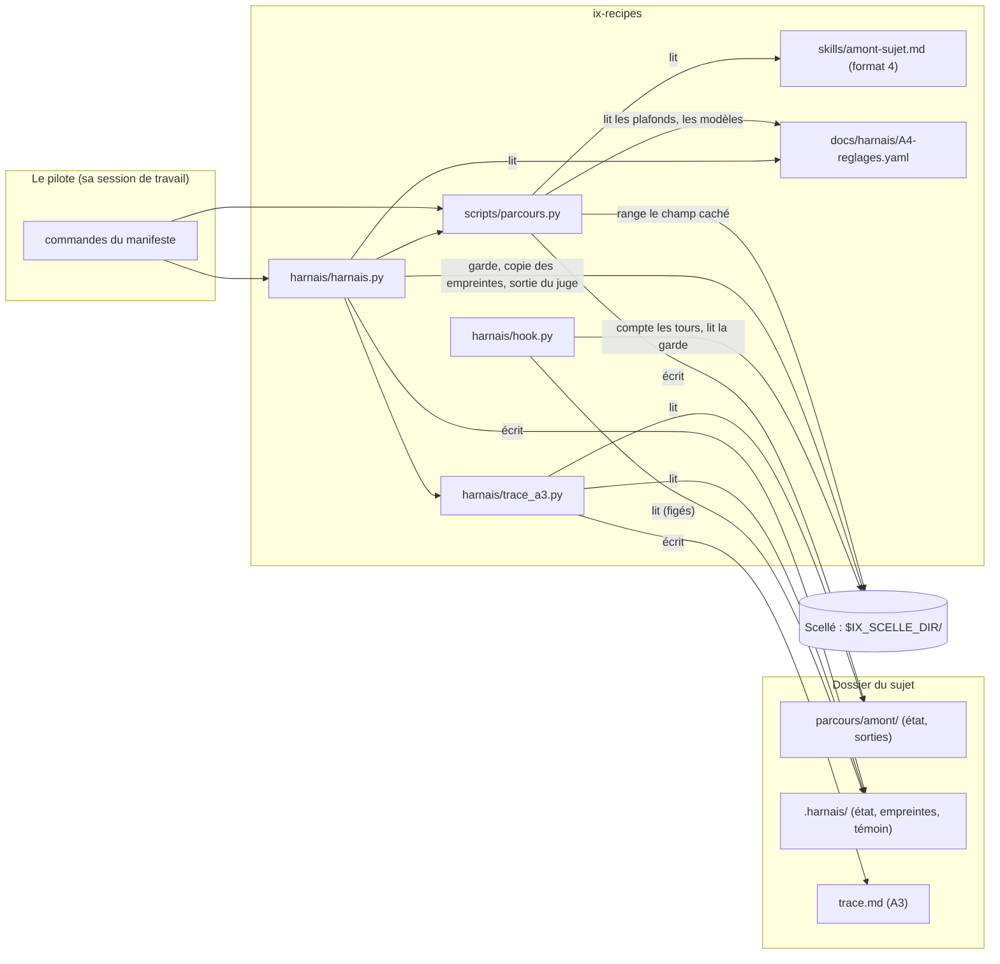

# Architecture du harnais de la procédure « traiter un sujet de bout en bout »

Ce document décrit comment le harnais est fait : ses composants, ce qu'ils échangent, où vit chaque donnée, ce que chaque brique garantit et ce qu'elle ne garantit pas. Il part d'`A6-architecture.md`, qui décrivait les pièces de la partie A sans harnais et le contrat qu'un harnais devait tenir. Ce que le harnais doit faire est dans `spec-harnais.md`.

Étiquettes : **[confirmé]** (donné par le cadrage ou lisible dans le code), **[hypothèse]** (suppose une échelle ou un usage), **[ouvert]** (à décider, avec qui).

## 1. Résumé

- **Architecture retenue.** Une **recette de format 4** (`skills/amont-sujet.md`) jouée par l'**exécuteur** d'ix-recipes pour l'amont (étapes 1 à 3) ; des **outils** en ligne de commande et un **hook** pour l'aval (étapes 4 à 6), tous dans le dépôt, sur une branche à eux. Les composants ne s'appellent pas : le pilote les enchaîne, et ils se parlent par des **fichiers** (réglages A4, trace A3, état JSON).
- **Charge sur laquelle elle repose.** Un pilote, un sujet à la fois, un passage de plusieurs heures dont l'attente humaine est la plus grosse part, quelques dizaines de lignes de trace. Rien ne justifie une base, un service ni un verrou.
- **Hypothèse la plus risquée.** Que les hooks de Claude Code se comportent en session réelle comme leur documentation le dit : `Stop` se déclenche après chaque tour de la boucle `/goal`, `continue: false` l'arrête, `PreToolUse` refuse un outil sur le code 2. B ne joue aucune vraie session (aucun appel de modèle) : les hooks sont essayés en les appelant avec des événements d'essai (§8). Autre limite : un hook ne voit pas toutes les formes d'une commande shell ; le niveau exact de chaque protection (« interdit et détecté » pour O5, O10 et O11, depuis la révision 2B du 19/10/2026), le **résidu** et le détecteur de chacun de ses gestes sont dits en §8 et dans `spec-harnais.md` §6.
- **Décisions déjà prises, rappelées.** Le code vit dans ix-recipes (DB2) ; les formats 1 à 3 et la page de suivi ne changent pas (CB19) ; rien n'est modifié dans ix-skills (CB20) ; Fable n'est jamais dans la recette (CB10).

## 2. Exigences

### 2.1 Fonctionnelles

Elles sont dans `spec-harnais.md` §7 (R1 à R8, F1 à F6, A1 à A9, T1 à T4). Ici, seules comptent celles qui décident de la forme : l'amont tient des **boucles bornées**, un **champ caché** et un **arrêt avant une étape jouée à part** ; l'aval tient des **compteurs**, un **gel**, un **scellé**, un **gel du livrable** et un **juge**.

### 2.2 Non fonctionnelles

| # | Exigence | Étiquette |
|---|---|---|
| N1 | Un coût de construction et d'entretien raisonnable pour un mainteneur seul | confirmé (intention) |
| N2 | Aucun appel de modèle dans les essais ; chaque moyen essayé sur un cas qui passe et sur un cas refusé | confirmé (CB37) |
| N3 | Les formats 1 à 3, la page de suivi et ix-skills ne changent pas de comportement | confirmé (CB19, CB20) |
| N4 | Aucune valeur de réglage (plafond, modèle, suite) n'est écrite dans le code : tout vient d'A4 | confirmé (A4, H1) |
| N5 | Aucun emplacement de scellé n'est écrit dans un fichier que le producteur lit ; l'emplacement est une entrée donnée à l'exécution | confirmé (CB14, CB15) |
| N6 | Une trace lisible sans Claude Code et exploitable par programme sans heuristique | confirmé (A3) |

### 2.3 Contraintes de contexte

Un pilote (Amiel), un sujet de type « code » à la fois, sur macOS ; Python de la bibliothèque standard côté exécuteur et outils (`pyyaml` et `jsonschema` seulement pour `build.py`) ; `git` pour le gel du livrable ; `claude` trouvé par `PATH` pour le juge **[confirmé]**.

## 3. Estimation de charge

Écrite avant tout choix, comme le format l'exige.

| Quantité | Calcul | Étiquette |
|---|---|---|
| Utilisateurs | 1 pilote, 1 sujet à la fois | confirmé |
| Appels de modèle de l'amont | 11 étapes, plus au plus 2 passes par boucle (3 boucles) : de l'ordre de 15 à 20 appels | hypothèse |
| Lignes de T3 | étape 0, ~15 lignes d'amont, 2 pauses, 1 gel, les tours (jusqu'à 40 + 3), 1 fin de production, quelques appels du juge : de l'ordre de 70 au plus | hypothèse |
| Écritures de l'état | une par commande du harnais (un tour = une écriture de l'état et de la trace) : une toutes les quelques minutes, au plus une par seconde pendant les essais | hypothèse |
| Concurrence en écriture | nulle : un seul processus à la fois sur un sujet ; l'exécuteur prend un verrou par parcours | confirmé |
| Taille de la trace | quelques centaines de lignes de tableau au plus ; elle est reconstruite à chaque commande en une fraction de seconde | hypothèse |
| Coût à l'usage | le harnais n'appelle qu'un modèle, le juge ; l'amont coûte ce que coûtent ses appels (`claude -p`, `total_cost_usd`) | confirmé |

**Conclusion.** Des fichiers texte et JSON suffisent. Aucun verrou n'est ajouté au-delà de celui de l'exécuteur, aucune base, aucun service.

## 4. Composants

| Composant | Rôle | Nature | Où |
|---|---|---|---|
| **Recette de l'amont** | joue les étapes 1 à 3 : 11 étapes, 2 pauses, 3 boucles bornées, 1 champ caché, 1 arrêt avant Fable | recette de format 4 | `skills/amont-sujet.md` |
| **Exécuteur, format 4** | joue la recette : isole chaque étape, compte les passes, range le champ caché au scellé, s'arrête avant l'étape externe, attend le choix du pilote aux plafonds | code | `scripts/parcours.py` (`format4_errors`, `settle_verdict`, `hold_external`, `seal_*`, commandes `supply` et `suite`) |
| **Contrôle de build, format 4** | refuse en format 4 une étape parallèle, une étape qui écrit, le modèle `fable` ; vérifie plafonds et rôles contre A4 | code | `build.py` (`format4_errors`, `reglages_errors`) |
| **Page de suivi** | joue les formats 1 à 3 ; refuse de créer un parcours au format 4 | code, modifié au minimum | `scripts/interface.py` (`PAGE_FORMATS`) |
| **Outils de l'aval** | lancer, suite, contre-vérification, gel, empreintes, tours, regel, fin de production, juge, ouverture, scellé | code | `harnais/harnais.py` |
| **Hook de gel** | refuse les écritures et les appels que la production ne doit pas faire | code + déclaration | `harnais/hook.py`, `harnais/hooks.json` |
| **Trace A3** | écrit, contrôle et traduit : T1 à T11 reconstruits de l'état de l'amont et de celui du harnais | code | `harnais/trace_a3.py` |
| **Manifeste** | l'interface : 12 chemins, 14 valeurs, 14 commandes | fichier | `harnais/points-d-entree.env` |
| **Pièces migrées** | A3, A4, A5, A6, A7, A8 | documents | `docs/harnais/` |
| **Réglages** | seul endroit où s'écrit une valeur de réglage | YAML | `docs/harnais/A4-reglages.yaml` |



Le couplage est unidirectionnel : le harnais dépend de l'exécuteur (il importe `parcours.py`), jamais l'inverse. L'exécuteur ne connaît ni le harnais ni la trace A3 : il écrit son état, et c'est `trace_a3.py` qui le traduit (livrable L4).

## 5. Flux d'un sujet

| Étape de la procédure | Qui | Commande ou geste | Ce qui s'écrit |
|---|---|---|---|
| 0 Brief | pilote | pose `demande.md` ; `CMD_LANCER code` | T1, T2, l'étape 0 ; le parcours `amont` ; `.harnais/etat.json` |
| 1a à 1d | exécuteur | `parcours.py next` | `parcours/amont/NN-<étape>.md` ; une ligne de passe par appel |
| Pause 1 | pilote | `parcours.py answer` | `answers.md` |
| 1e, vérification de forme, 2A, vérification du goal, 2B | exécuteur | `next` | idem ; le champ caché au scellé |
| Contre-vérification | pilote | appelle Fable après accord ; `CMD_CONTRE_VERIF <fichier>` | `parcours.py supply` : la sortie et son verdict |
| 3, pause 2 | exécuteur, pilote | `next`, `validate` | l'écart de réconciliation |
| Gel | pilote | `CMD_GELER <livrable> <fichiers…>` | empreintes (sujet et scellé), T9, hooks déclarés (`PreToolUse`, `Stop`, `UserPromptSubmit`), garde ouverte en phase « goal » |
| 4 Production | session sous `/goal`, **sans `IX_SCELLE_DIR`**, qui ne lance rien du harnais | le hook `Stop` compte chaque fin de tour dans la garde ; `UserPromptSubmit` et `PreToolUse` refusent la suite au plafond (§8) | la garde ; la ligne de T3 est écrite au geste suivant du pilote |
| Fin de production | pilote | `CMD_FIN_PRODUCTION` | commit et étiquette du livrable |
| 5 Jugement | pilote | `CMD_JUGE` | la sortie du juge au scellé ; `constat-juge.md` |
| 6 Correction | session sous `/goal`, sans `IX_SCELLE_DIR` | comme la production ; `juge` a passé la phase de la garde à « correction », qui a son compteur | compteur à part |
| Retour en 2B | pilote | `CMD_SUITE … contourner`, `CMD_REGELER` | dérogation en T7 ; nouvelles empreintes |
| Fin du jugement | pilote | `CMD_OUVRIR` | `jugement/` ; T9 passe à `ouvert` |

## 6. Contrats d'interface

### 6.1 Le manifeste

`harnais/points-d-entree.env` : une ligne `CLE=valeur` par clé, sans guillemets, `#` pour un commentaire. Quarante clés.

| Groupe | Clés | Valeur |
|---|---|---|
| chemins (12) | `A3`, `A4`, `A5`, `A6_ARCHI`, `A6_SPEC`, `A7_GUIDE`, `A7_TRACE`, `A8`, `SPEC`, `ARCHI`, `HOOKS_FICHIER`, `MODELE_VERDICT` | relatifs à la racine d'ix-recipes |
| valeurs (14) | `RECETTE`, `TRACE`, `ETAPE_EVAL_CADRAGE`, `ETAPE_CADRAGE`, `ETAPE_CLOTURE`, `ETAPE_VERIF_LIVRABLES`, `ETAPE_GOAL`, `ETAPE_VERIF_GOAL`, `ETAPE_CRITERES`, `ETAPE_CONTRE_VERIF`, `CHAMP_VERDICT`, `VERDICT_OK`, `VERDICT_REPRENDRE`, `CHAMP_CACHE` | l'identifiant de la recette ; le fichier de trace (`trace.md`) ; les identifiants d'étapes ; le champ de verdict (`verdict`) et ses deux valeurs (`OK`, `REPRENDRE`) ; le champ caché (`part_cachee`) |
| commandes (14) | `CMD_LANCER`, `CMD_TRACE`, `CMD_SUITE`, `CMD_CONTRE_VERIF`, `CMD_GELER`, `CMD_SCEAU`, `CMD_EMPREINTES`, `CMD_TOUR`, `CMD_TOUR_CORRECTION`, `CMD_REGELER`, `CMD_FIN_PRODUCTION`, `CMD_JUGE`, `CMD_OUVRIR`, `CMD_HOOK` | une commande, lancée par `sh -c` dans le dossier du sujet avec `R`, `S` et `L` exportés ; code 0 = accepté, non nul = refusé avec la cause |

### 6.2 Les commandes de l'aval

| Commande | Arguments | Refuse… |
|---|---|---|
| `lancer` | `TYPE [options de parcours.py new]` | un type absent des réglages ou marqué « partie C » (rien n'est créé) ; `IX_SCELLE_DIR` absente ou fautive ; un sujet déjà lancé. Écrit au scellé le jeton du sujet et la garde (compteurs à zéro, plafonds copiés d'A4, phase « avant le gel ») |
| `trace` | — | une trace qui ne tient pas A3 |
| `suite` | `PLAFOND SUITE [NOMBRE\|TEXTE]` | un appelant qui ne tient pas le scellé du sujet ; un état qui ne concorde pas avec la copie du scellé ; un plafond non atteint ; une suite hors de `suites_au_plafond` ; un nombre ou un texte manquant |
| `contre-verif` | `FICHIER` | un appelant qui ne tient pas le scellé ; tout autre arrêt que celui de l'étape externe |
| `geler` | `LIVRABLE FICHIER…` | un appelant qui ne tient pas le scellé ; un sujet déjà gelé ; un fichier absent ou hors du sujet ; un livrable qui contient le sujet |
| `empreintes` | — | un appelant qui ne tient pas le scellé ; le premier fichier figé qui a changé, disparu ou dont la copie du scellé ne concorde plus ; un état qui ne concorde plus avec ce que le pilote a scellé |
| `tour`, `tour-correction` | — | (**outil du pilote et des essais** : la production ne les lance pas, les hooks comptent ses tours) sans `IX_SCELLE_DIR` ; sans gel ; sur un écart de compteur ; sur un écart d'empreinte (contre la copie du scellé) ; tant que le goal garde un emplacement réservé non rempli ; au plafond sans suite ; un sujet abandonné. Le même compte que le hook `Stop`, dans la même garde |
| `regeler` | — | un appelant qui ne tient pas le scellé ; tant qu'aucun « contourner » n'est consigné depuis le dernier gel |
| `fin-production` | — | sans gel (lancée par le pilote ou par la production : n'exige pas `IX_SCELLE_DIR`) |
| `juge` | — | un appelant qui ne tient pas le scellé ; un état qui ne concorde pas avec ce que le pilote a scellé ; un livrable qui a bougé depuis son étiquette ; un écart d'empreinte ; l'absence de `claude` dans le `PATH` ; un verdict qui n'est pas au format |
| `ouvrir` | — | un appelant qui ne tient pas le scellé ; avant la fin des tours de correction |
| `sceau` | — | (outil du pilote) un appelant qui ne tient pas le scellé |
| `hook` | événement `PreToolUse` en JSON sur l'entrée standard | code 2 pour un refus, 0 sinon |
| `hook-stop`, `hook-prompt` | `--garde` (le scellé du sujet, en hexadécimal) ; événement JSON sur l'entrée standard | code 0 ; la décision est en JSON sur la sortie standard : `continue: false` (fin de tour qui arrête la boucle), `decision: block` (début de tour refusé) |

### 6.3 Ce que le format 4 ajoute à une étape

| Clé | Sens |
|---|---|
| `stage` | l'étape de la procédure (`1a`… `3`), pour la trace |
| `role` | la clé de `modeles` d'A4 dont le modèle s'applique à l'appel |
| `verdict_field` | le champ de `transmits` dont la première ligne vaut `OK` ou `REPRENDRE` |
| `loop` | `{to: <étape antérieure>, ceiling: <plafond d'A4>}` : sur `REPRENDRE`, renvoyer à `to`, au plus `ceiling` passes |
| `hidden` | des champs de `transmits` que l'exécuteur range au scellé |
| `external` | l'exécuteur s'arrête avant l'étape ; le pilote rend sa sortie par `supply` |

Les clés refusées en format 4 : `parallel: true`, `writes: true`, `model: fable`. Toute la description est dans `docs/format-4.md`.

### 6.4 Le format du verdict du juge

Un tableau Markdown sous le titre « Lignes », une ligne par exigence :

```
| exigence | part | verdict | preuve |
|---|---|---|---|
| <référence de l'exigence> | visible ou cachée | passe ou échec | <la preuve> |
```

`harnais/modele-verdict.md` en est un modèle. Le constat destiné au producteur (`constat-juge.md`) nomme la référence de chaque exigence en échec et donne la preuve d'une exigence **visible** seulement.

## 7. Stockage

Aucune base. Tout est fichier texte ou JSON.

| Lieu | Contenu | Règle |
|---|---|---|
| `docs/harnais/` | les pièces migrées, la spec, l'architecture, les guides | une source par pièce (CB18) |
| `harnais/` | le code des outils, le manifeste, la déclaration du hook, le modèle de verdict | tout le code de B vit ici, sur la branche |
| dossier du sujet : `demande.md`, `parcours/amont/`, `trace.md`, `goal.md` | ce que le producteur peut lire | aucun chemin de scellé n'y figure ; le champ caché n'y figure que sous la forme d'une marque et d'une empreinte |
| dossier du sujet : `.harnais/etat.json`, `.harnais/empreintes.sha256`, `.harnais/temoin.json` | l'état du harnais (un **affichage** : suites, gel, livrable, appels du juge, compteurs recopiés de la garde), les empreintes, et le témoin de la garde (séquence, tête, tours) | lisibles du producteur, protégés par le hook ; les empreintes sont doublées au scellé ; ce que seul le pilote écrit dans l'état (suites, tours ajoutés, gel) l'est aussi ; ce qui s'applique (compteurs, plafond) est dans la garde, que l'état ne fait que refléter |
| dossier du sujet : `.claude/settings.json` | les hooks déclarés au gel, dont le pointeur vers le scellé (`--garde`, en hexadécimal) | écriture **et lecture** refusées au producteur |
| dossier du sujet : `constat-juge.md` | l'exigence de chaque ligne en échec | écrit par `juge`, jamais le contenu d'une ligne cachée |
| dossier du sujet : `jugement/` | la part cachée et la trace du juge, **à la fin du jugement seulement** | versées octet pour octet ; T9 passe à `ouvert` |
| dossier du livrable (relatif au sujet ou absolu) | le livrable, un dépôt git | commité et étiqueté en fin de production ; `.git/ix-sujet` y retient le sujet, pour le hook |
| `$IX_SCELLE_DIR/<nom tiré au hasard>/` | le scellé : la **garde** (`garde.json` : compteurs, plafonds, phase, fichiers figés, sha256 du jeton), le champ caché (`<recette>/<étape>.<champ>.md`), le message de l'étape externe, la copie des empreintes, `jeton` (la preuve de détenir le scellé), `pilote.json` (la copie de ce que seul le pilote écrit dans l'état), la sortie et les métadonnées de chaque appel du juge ; `$IX_SCELLE_DIR/index.json` : le nom tiré au hasard de chaque sujet, clé son chemin | hors de tout dépôt, hors de tout chemin que lit le producteur, mode 0700 ; **donné à l'exécution**, jamais écrit en clair ; le nom du sous-dossier n'est calculé depuis rien |

Le scellé est refusé (par l'exécuteur et par le harnais) s'il est dans un dépôt git ou s'il contient, ou s'il est sous, le dossier du sujet, celui du livrable ou ix-recipes.

### 7.0 La garde (`garde.json`, au scellé) et son témoin

La garde est ce que les hooks lisent : `phase` (avant le gel, goal, correction, ouvert), `tours` (un compteur par phase comptée), `plafonds` (copiés d'A4 au lancement), `extra` (les tours que `suite` a ajoutés), `abandonne` et `livre_avec_reserve`, `gel` (fichiers figés, nombre de regels), `journal` (un événement par tour compté : rang, compteur, rang dans le compteur, limite, plafond atteint, heure), `pilote_sha256` (la référence du jeton), `seq` et `tete` (le sha256 du contenu). Chaque écriture augmente `seq`, recalcule `tete` et récrit `.harnais/temoin.json` (`seq`, `tete`, `tours`). Un seul écrivain à la fois (un verrou `flock` au scellé) : le hook `Stop` et les commandes du pilote ne se marchent pas dessus.

### 7.1 L'état du harnais (`.harnais/etat.json`)

| Clé | Contenu |
|---|---|
| `sujet`, `titre`, `type`, `pilote`, `debut` | T1 |
| `reglages` | version, empreinte, plafonds, limites de production, suites, modèles : copiés au lancement |
| `lignes` | les gestes du harnais qui sont des lignes de T3 (gel, tours, regel, fin de production, juge) |
| `tours`, `extra`, `seq_journal` | **recopiés de la garde** à chaque commande du pilote : les compteurs de tours, les tours ajoutés par « relancer », et le rang du dernier tour mis en T3. L'état n'en fait pas foi : un état qui annonce plus de tours que la garde est refusé |
| `plafonds_atteints`, `suites` | T7 de l'aval |
| `gel` | fichiers figés, dossier du livrable, nombre de regels, sha256 du fichier d'empreintes |
| `livrable`, `livrables` | étiquette, commit, empreinte du contenu |
| `juge` | les appels du juge, avec le nombre d'exigences en échec |
| `elements` | les lignes de T9 |

### 7.2 L'état de l'amont (`parcours/amont/state.json`)

L'état de l'exécuteur (docs/executeur.md §2) plus, en format 4 : `reglages` (les plafonds copiés au lancement), `models` (le modèle de chaque rôle, figé à la création), `loops` (passes, passes ajoutées, historique des verdicts), `ceilings` (les plafonds atteints), `suites`, `pauses`, et, par étape, `runs` (une entrée par passage : modèle, moteur, durée, coût).

## 8. Garanties et limites

Le détail obligation par obligation est dans `spec-harnais.md` §6, qui fixe le sens des mots **interdit et détecté**, **mécanisme**, **hook**, **discipline** et **contrôle du pilote**. **Révision 2B du 19/10/2026 (décision d'Amiel, ligne 55 de la grille) :** pour O5, O10 et O11, le niveau est « interdit et détecté » : un refus pour les formes que le hook ou l'outil reconnaît, et pour chaque geste que ce refus laisse passer, un détecteur nommé avec son moment, ou « rien dans le harnais ». Un vrai empêchement demande une isolation par le système, hors de B-a. Ici, ce que chaque brique garantit, et ce qu'elle ne garantit pas.

**Qui lance quoi.** La session de production ne lance **rien** du harnais (`fin-production` mis à part, si elle le veut, et qui n'exige rien) : ses tours sont comptés par les hooks, qui tournent dans son environnement et lisent la garde au scellé par le pointeur des réglages. Le pilote lance tout le reste, avec `IX_SCELLE_DIR`. Huit commandes exigent de plus de **tenir** le scellé du sujet (`sceau`, `suite`, `contre-verif`, `geler`, `regeler`, `juge`, `ouvrir`, `empreintes`) : elles se refusent d'elles-mêmes, quelle que soit la forme de l'appel, et ce qu'elles changent vit au scellé (E13).

**Plafonds (O5).**
- *Passes de l'amont : mécanisme.* L'exécuteur les compte, s'arrête au plafond et ne rejoue rien ; le pilote seul le mène.
- *Tours : interdit et détecté.* Trois hooks de Claude Code, déclarés au gel, tiennent le compte sans que la production lance quoi que ce soit. `Stop` compte un tour à chaque fin de tour dans la garde ; au plafond, sur un écart de compteur ou d'empreinte, il rend `continue: false`, qui arrête la boucle. `UserPromptSubmit` refuse de commencer un tour dans les mêmes cas. `PreToolUse` refuse tout outil dans les mêmes cas : une boucle relancée par un autre chemin que `/goal` (un message du pilote, le résultat d'une tâche de fond) n'a plus d'outil. Le compteur et sa référence d'intégrité vivent **au scellé** (la garde) et dans un **témoin** du sujet : chaque écriture les accorde (même séquence, même tête). Un compteur remis à zéro dans l'un des deux seuls est **vu avant l'outil suivant**, non au prochain geste du pilote ; remis à zéro dans les deux d'un même geste, il n'est vu par rien dans le harnais (contrôle du pilote CP1, §8 plus bas). L'état du sujet, que la production peut écrire, ne sert à rien d'appliqué : les hooks ne le lisent pas, et la garde l'écrase au geste suivant du pilote. Un tour compté deux fois (par `tour` et par le hook) ne fait qu'avancer le plafond. **Non éprouvé en session réelle** (voir plus bas).
- *La suite : interdit et détecté.* Elle n'est consignée que par `suite`, qui refuse tout appelant qui ne tient pas le scellé : ni un `suite` appelé par un chemin inattendu, ni un script copié, ni une fonction importée ne passe sans lui. Un appelant qui tient le scellé par le résidu (ou par `IX_SCELLE_DIR` laissée dans l'environnement) consigne une suite que rien n'empêche : la ligne qu'elle laisse en T7 est ce qui la fait voir, par le contrôle du pilote CP3. Elle relève la limite dans la garde, que les hooks lisent. L'état qui la porte (`.harnais/etat.json`) n'est pas couvert par les empreintes ; il l'est par la copie que le pilote en garde au scellé (`pilote.json`) : une suite écrite à la main dans l'état est refusée par `suite`, `empreintes`, `juge`, `regeler`, `geler` et `ouvrir`, et ne relève aucun plafond.

**Gel (O10) : interdit et détecté.** Quatre couches : (1) le hook refuse l'écriture des fichiers figés et de l'état quand il en reconnaît la forme ; (2) les hooks comparent les fichiers figés à la copie des empreintes **gardée au scellé** avant chaque outil, à chaque début et à chaque fin de tour, sans que la production lance quoi que ce soit : un fichier changé par une forme que le hook ne reconnaît pas arrête la boucle et refuse tous les outils jusqu'à ce que le pilote le règle ; (3) `empreintes`, `tour` et `juge` du pilote font la même comparaison ; (4) le juge refuse un livrable qui a bougé depuis son étiquette. Ce que ces couches ne voient pas : un fichier modifié puis restauré entre deux contrôles ; un fichier figé récrit avec `.harnais/empreintes.sha256` **et** la copie du scellé d'un même geste (par le résidu). Pour ces deux gestes, **rien dans le harnais** ne détecte.

**Scellé (O11) : interdit et détecté.** Le champ caché sort de la sortie de l'étape au moment où il est produit : l'exécuteur le range au scellé et ne laisse dans le dossier qu'une marque et une empreinte (sortie, trace du message de relance, état). Aucune étape jouée par l'exécuteur ne le reçoit ; seule l'étape externe le reçoit, et son message est écrit au scellé. Le juge tourne depuis un dossier neutre sous `$TMPDIR`, supprimé après l'appel avec le dossier de projet que `claude` aurait créé pour lui. L'emplacement est donné par `IX_SCELLE_DIR`, sans valeur par défaut ni suggestion ; **le sous-dossier de chaque sujet a un nom tiré au hasard**, rangé dans l'index du scellé, qu'aucun fichier du sujet n'écrit (l'état de l'amont ne porte plus de `seal_key`). L'environnement de la session de production ne porte pas la variable. Le hook, qui n'en dépend pas, connaît le scellé par le **pointeur** des réglages (D-L15) et le refuse **par son chemin** : `Read`, `Glob`, `Grep`, les outils d'écriture, et les formes shell qui désignent, listent ou cherchent (`find "$TMPDIR" -name jeton`, `grep -r … /`, `ls -R`, `cat …/*/jeton`, `mdfind`, `sh -c '…'`, `$( )`), après résolution de `~`, des variables d'environnement et des jokers. Il refuse aussi de lire les réglages qui portent le pointeur. Le refus ne repose donc plus sur la propreté de l'environnement de lancement. Une lecture par une forme que le hook ne résout pas n'est pas empêchée.

**Ce que le hook ne voit pas, et le résidu.** Un hook reçoit le nom d'un outil et ses paramètres. Pour `Bash` il ne lit qu'une chaîne. Il résout les mots qu'il comprend ; il ne résout pas ce qui n'est connu qu'à l'exécution : un interpréteur (`python3 -c`, `perl`, `node`, `awk`) qui construit un chemin, lit un fichier ou l'environnement, le résultat d'une substitution, une variable que le hook ne connaît pas, un script écrit puis lancé. **Une commande du pilote ne repose pas sur lui** pour un appelant qui ne tient pas le scellé ; les compteurs et le plafond ne reposent pas sur ce qu'il reconnaît d'une commande (ils sont comptés à chaque fin de tour). **Le résidu** est donc celui-ci : un processus du même utilisateur système, lancé par la production, qui atteint par une de ces formes la garde, le scellé ou les réglages. Le système ne le lui interdit pas, c'est le même compte. Le tableau de `spec-harnais.md` §6.2 dit pour chaque geste ce qui le détecte et quand. En résumé :

| Geste | Détecteur | Moment |
|---|---|---|
| garde seule ou témoin seul récrit | tête de la garde et témoin, par les hooks | avant l'outil suivant ; début et fin de tour |
| état récrit | `synchroniser` (la garde écrase l'état) | geste suivant du pilote |
| faux scellé complet | `exiger_pilote`, `empreintes` | commande du pilote suivante |
| garde **et** témoin récrits d'un même geste | **rien dans le harnais** ; CP1 du pilote (lignes `tour n` de T3 contre événements `Stop` de la transcription) | à chaque retour de la main, avant `fin-production`, `juge` et `ouvrir` |
| commande du pilote lancée avec le vrai scellé (`suite`…) | pour `suite` : T7 (CP3 du pilote : T7 contre les suites qu'il a consignées) ; les autres commandes : rien dans le harnais ; `IX_SCELLE_DIR` laissée dans l'environnement : non détectée, prévenue par la vérification de l'environnement avant la session (A7 §2) | à chaque retour de la main, avant le geste suivant du pilote ; avant chaque lancement de la session |
| fichier figé et ses deux copies d'empreintes récrits d'un même geste | **rien dans le harnais** | — |
| fichier figé modifié puis restauré entre deux contrôles | non détecté | — |
| lecture de la part cachée ou du jeton | **rien dans le harnais** ; CP2 du pilote (noms du scellé et marqueur de la part cachée cherchés dans la transcription) | à chaque retour de la main, avant `juge` et avant `ouvrir` |

**CP1 à CP3 sont des gestes du pilote, à la main, non éprouvés** : le harnais ne les fait pas (aucun code de `harnais/` ne lit la transcription d'une session) et ne les rappelle pas ; CP1 et CP3 n'ont jamais été faits, CP2 l'a été à la main au rejugement du tour 2. Leur dépendance : la transcription de la session de production, dont le format n'est pas garanti par le harnais.

**Si le résidu doit se fermer (hors de B-a, révision 2B).** Le bac à sable de la commande Bash de Claude Code (`sandbox.enabled`, `sandbox.filesystem.denyRead` sur le dossier des scellés, `allowUnsandboxedCommands: false`) fait appliquer par le système le refus de lire ou d'écrire le scellé à toute commande shell et aux processus qu'elle lance, quelle que soit sa forme ; `Read`, `Glob` et `Grep` restent refusés par le hook. Un compte système séparé qui possède le scellé fait de même pour tout. **Non livré et non éprouvé** : le bac à sable change ce que la production peut faire (réseau, écritures hors de son dossier), et B n'a aucun essai de session réelle. À examiner au premier passage réel (B-b).

**Ce qui n'est pas éprouvé.** Les hooks sont essayés en les appelant avec des événements d'essai (`tests/test_harnais.py` : `CounterHookTests`, `SealClosedTests`, `PilotProofTests`), comme B essaie tout mécanisme sans appel de modèle. Que `Stop` se déclenche après chaque tour d'une boucle `/goal` et qu'un `continue: false` l'arrête repose sur la documentation de Claude Code (« `/goal` and a Stop hook both fire after every turn » ; une boucle arrêtée par un hook passe en pause), non sur une session jouée. Que les hooks d'un projet ne se chargent qu'après la confiance accordée au dossier, et ne se chargent pas si `disableAllHooks` est vrai, est aussi tiré de cette documentation : si la session ne les charge pas, rien ne compte, et le pilote le voit à la trace. **Les contrôles du pilote CP1 à CP3 (§8) ne sont pas éprouvés** : aucun n'est dans le code du harnais, CP1 et CP3 n'ont jamais été faits.

## 9. Compromis

| Décision | Plus facile | Plus difficile | À revoir quand |
|---|---|---|---|
| **Une recette de format 4 plutôt que le format 4 complet** | l'exécuteur et `build.py` changent peu ; l'isolation reste celle de l'exécuteur | pas de parallèle (1a et 1b se suivent), pas d'étape qui écrit : le harnais écrit tout | le coût d'un sujet réel montre que le parallèle manque |
| **Le renvoi de 1d vers 1c, non vers 1a** | la fiche de contexte n'est pas rejouée ni revalidée | s'écarte de la lettre de la procédure | Amiel le conteste (question Q3 de la spec) |
| **Un état JSON et une trace reconstruite** plutôt qu'une trace écrite ligne à ligne | l'idempotence ; une trace toujours cohérente avec l'état | l'état est la source ; la trace n'est pas éditable à la main | si un harnais doit écrire en concurrence |
| **Le scellé donné par une variable d'environnement, trouvé par le hook grâce à un pointeur** | aucun chemin en clair dans aucun fichier ; testable avec un dossier jetable | le pilote doit l'exporter pour chacune de ses commandes ; le pointeur (hexadécimal) est dans les réglages du sujet, que le hook ferme à la lecture et dont un interpréteur peut décoder le contenu : c'est le résidu | un compte séparé ou le bac à sable de Bash |
| **Les hooks déclarés au gel dans les réglages du sujet** plutôt qu'installés dans la configuration de la machine | rien ne change pour les autres projets ; le gel est portable avec le sujet | la commande cite `$R` : le pilote l'exporte pour la session de production, sinon tous les appels d'outil échouent ; les hooks de projet ne se chargent qu'après la confiance accordée au dossier | si le harnais devient un plugin |
| **L'étape externe pour Fable** plutôt qu'un appel dans la recette | l'accord d'Amiel précède toujours l'appel ; la recette reste sans Fable | une commande de plus, et une main à rendre | si l'accord est donné une fois pour toutes |
| **Le coût `n.c.` pour les jetons** plutôt qu'une estimation | la trace ne dit rien de faux | le coût des étapes 4 et 6 reste à relever dans la session | si l'exécuteur lit l'usage de `claude -p` |
| **Le juge lancé par `claude -p`** plutôt que par une session | un coût et un modèle mesurés ; un dossier neutre | les outils autorisés du juge sont à confirmer au premier passage réel | premier passage réel (B-b) |

## 10. Risques et modes de panne

| # | Mode de panne | Cause | Détection | Réponse |
|---|---|---|---|---|
| R1 | fichier figé modifié | une écriture que le hook ne voit pas | les hooks, avant chaque outil et chaque tour, contre la copie du scellé ; `empreintes` du pilote | arrêt au premier écart, le fichier est nommé ; reprise par « contourner » et regel |
| R2 | fuite de la part cachée | le champ copié dans une autre sortie ; un chemin de scellé écrit ; une trace de `claude` | recherche d'un marqueur dans le dossier du sujet (les essais le font) ; T9 écrit `non écrit` ; pour une lecture du scellé par le résidu, rien dans le harnais : CP2 du pilote (§8) | le champ caché ne va à aucune étape jouée ; le scellé n'est dans aucun fichier |
| R3 | réglages qui divergent | A4 modifié en cours de parcours | T1 consigne l'empreinte d'A4 ; les plafonds et les modèles sont figés dans l'état à la création | un changement vaut pour les parcours suivants |
| R4 | trace trompeuse | cellule vide, coût estimé présenté comme mesuré | `trace_a3.controler` refuse d'écrire la trace | corriger la source de l'écart |
| R5 | plafond de tours dépassé | le hook `Stop` n'est pas chargé (dossier non approuvé, `disableAllHooks`, session lancée hors du dossier du sujet, `R` absent) | aucune ligne `tour n` dans la trace après une session ; `empreintes` vérifie que les hooks déclarés désignent le scellé ; sans `R`, tout outil est refusé | lancer la session dans le dossier du sujet avec `R`, après avoir approuvé le dossier |
| R5b | suite, tours ajoutés ou compteur remis à zéro à la main | écriture que le hook ne voit pas | la garde, le témoin et `pilote.json` : vus par les hooks (garde ou témoin seuls) et par `suite`, `empreintes`, `juge`, `regeler`, `geler`, `ouvrir` ; aucun plafond n'a bougé | corriger à partir de la garde ; reprendre par le pilote |
| R6 | le pilote oublie d'exporter `R`, ou exporte `IX_SCELLE_DIR` là où il ne faut pas | oubli | sans `IX_SCELLE_DIR`, toute commande du pilote est refusée nettement ; sans `R`, le hook échoue et la session de production est bloquée ; `IX_SCELLE_DIR` laissée dans l'environnement de la production **n'est plus la condition de O11** (le hook ferme le scellé par son chemin) mais n'est pas détectée par le harnais (le pilote la prévient par `env \| grep -c IX_SCELLE_DIR` avant la session) | exporter `R` ; lancer la production sans `IX_SCELLE_DIR` (A7 §5) |
| R7 | le juge ne tient pas le format du verdict | modèle qui s'écarte | `juge` refuse, garde la sortie au scellé et demande de refaire | refaire l'appel |
| R8 | le format 4 est joué par un lecteur qui ne le connaît pas | page ou exécuteur ancien | ils refusent la recette (« mettez à jour ») | mettre à jour |

## 11. Contrat étendu : où chaque obligation est tenue

| Obligation | Composant |
|---|---|
| O1, O2 | `harnais/harnais.py lancer` ; `build.py` et `parcours.py new` (`role`, `model`, `fable`) |
| O3, O4, O13, O14 | `harnais/trace_a3.py` |
| O5 | `parcours.py` (passes) ; `harnais/garde.py`, `harnais/hook.py` (`hook-stop`, `hook-prompt`, `hook`) et `harnais/harnais.py` (tours, suites) : passes : un mécanisme ; tours et suite : interdit et détecté (§8) |
| O6, O7, O8, O9 | la recette (`receives`, missions, pièces du dossier) ; `hook-prompt` et `tour` pour les emplacements |
| O10 | `geler`, `empreintes`, `tour`, `hook.py`, `garde.py` : interdit et détecté (§8) |
| O11 | `parcours.py` (champ caché, nom tiré au hasard), `commun.py` (le scellé, le jeton, le pointeur), `juge`, `hook.py` (le scellé refusé par chemin) : interdit et détecté ; un résidu, avec le détecteur de chacun de ses gestes (§8) |
| O12 | l'exécuteur (`pause`) |
| P2 | comme O10 |
| P3 | `suite` : `harnais.py` et `commun.py` (le jeton) ; l'arrêt au plafond par les hooks |
| P4, P5 | `juge`, `fin-production` |
| P10 | le scellé, le juge en dossier neutre |
| P12 | `regeler` |

## 12. Hypothèses d'échelle et ce qu'il faudra revoir

- **[hypothèse]** Un pilote, un sujet à la fois. Plusieurs sujets en parallèle feraient se croiser les états : il faudrait des verrous par sujet et un scellé par sujet (le scellé de chaque sujet est déjà un dossier à part, au nom tiré au hasard).
- **[hypothèse]** Un passage de quelques heures, une trace de quelques dizaines de lignes par table. Au-delà, reconstruire la trace à chaque commande serait lent.
- **[hypothèse]** Un seul type de sujet, « code ». Un autre type demande ses réglages, ses annexes de critères et ses skills de format ; le harnais le refuse tant que A4 le marque « partie C ».
- **À revoir si le système grandit** : un second pilote (le champ `pilote` et les accords), un client qui mène un sujet sans Claude Code (le harnais suppose Claude Code), un autre modèle que Claude (`claude` est appelé par nom).

## 13. Questions ouvertes

| # | Question | Bloquante ? | Qui décide |
|---|---|---|---|
| Q1 | les outils autorisés du juge et ses options exactes (`--allowedTools`) sont à confirmer sur un appel réel | non | Amiel, au premier passage réel |
| Q2 | lire l'usage (jetons) rendu par `claude -p` pour remplir T3 | non | Amiel |
| Q3 | le renvoi de 1d vers 1c | non | Amiel |
| Q4 | tranchée (D-L12 et D-L15 de la spec) : `IX_SCELLE_DIR` reste hors de l'environnement de la session de production ; le hook refuse l'accès au scellé par son chemin |
| Q7 (Q6 de la spec) | tranchée par Amiel le 19/10/2026 (révision 2B de la ligne 55) : O5, O10 et O11 sont « interdits et détectés », non « mécanisme qui empêche » ; un vrai empêchement demande une isolation par le système, hors de B-a (§8). À confirmer dans une vraie session `/goal`, à faire une première fois les contrôles du pilote CP1 à CP3, et à décider si le bac à sable de Bash ferme le résidu | non | Amiel, à B-b |
| Q5 | corriger l'acceptation de `model: fable` par l'exécuteur pour les formats 1 à 3 | non | Amiel, au bilan |
| Q6 | traduire A3 et A4 vers une forme propre au harnais : **non nécessaire**, le harnais lit A4 et écrit A3 tels quels | — | — |
