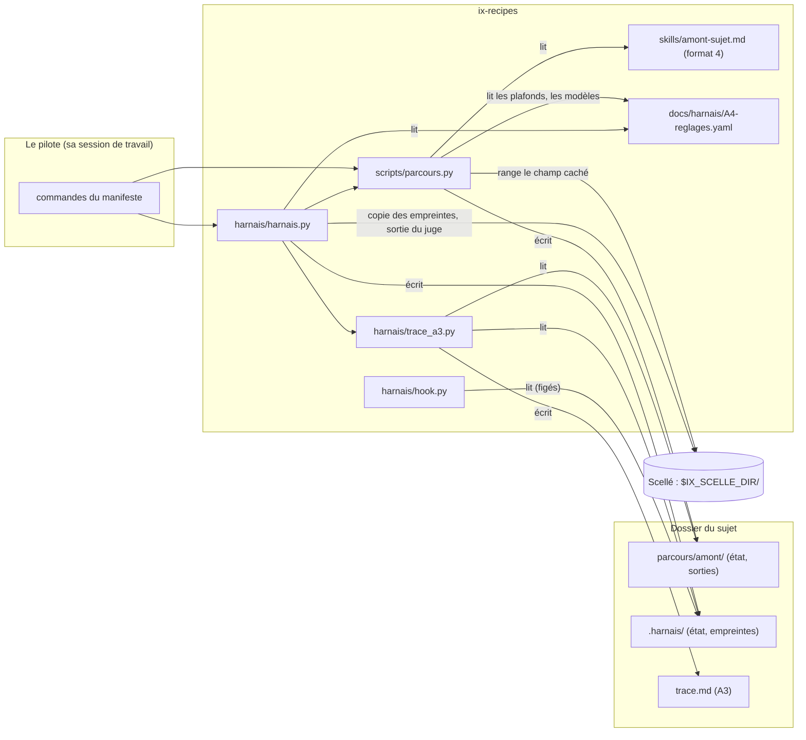

# Architecture du harnais de la procédure « traiter un sujet de bout en bout »

Ce document décrit comment le harnais est fait : ses composants, ce qu'ils échangent, où vit chaque donnée, ce que chaque brique garantit et ce qu'elle ne garantit pas. Il part d'`A6-architecture.md`, qui décrivait les pièces de la partie A sans harnais et le contrat qu'un harnais devait tenir. Ce que le harnais doit faire est dans `spec-harnais.md`.

Étiquettes : **[confirmé]** (donné par le cadrage ou lisible dans le code), **[hypothèse]** (suppose une échelle ou un usage), **[ouvert]** (à décider, avec qui).

## 1. Résumé

- **Architecture retenue.** Une **recette de format 4** (`skills/amont-sujet.md`) jouée par l'**exécuteur** d'ix-recipes pour l'amont (étapes 1 à 3) ; des **outils** en ligne de commande et un **hook** pour l'aval (étapes 4 à 6), tous dans le dépôt, sur une branche à eux. Les composants ne s'appellent pas : le pilote les enchaîne, et ils se parlent par des **fichiers** (réglages A4, trace A3, état JSON).
- **Charge sur laquelle elle repose.** Un pilote, un sujet à la fois, un passage de plusieurs heures dont l'attente humaine est la plus grosse part, quelques dizaines de lignes de trace. Rien ne justifie une base, un service ni un verrou.
- **Hypothèse la plus risquée.** Qu'un hook `PreToolUse` et des empreintes tiennent le niveau « mécanisme » pour le gel, alors qu'un hook ne voit pas toutes les écritures d'une commande shell et que les empreintes ne sont vérifiées avant un tour que si la session de production lance `tour` (§8). Le niveau exact de chaque protection est dit en §8 et dans `spec-harnais.md` §6 : trois obligations (O5 les tours, O10 le gel, O11 le scellé) n'ont pas tout à fait le niveau « mécanisme » que le cadrage vise.
- **Décisions déjà prises, rappelées.** Le code vit dans ix-recipes (DB2) ; les formats 1 à 3 et la page de suivi ne changent pas (CB19) ; rien n'est modifié dans ix-skills (CB20) ; Fable n'est jamais dans la recette (CB10).

## 2. Exigences

### 2.1 Fonctionnelles

Elles sont dans `spec-harnais.md` §7 (R1 à R8, F1 à F6, A1 à A9, T1 à T4). Ici, seules comptent celles qui décident de la forme : l'amont tient des **boucles bornées**, un **champ caché** et un **arrêt avant une étape jouée à part** ; l'aval tient des **compteurs**, un **gel**, un **scellé**, un **gel du livrable** et un **juge**.

### 2.2 Non fonctionnelles

| # | Exigence | Étiquette |
|---|---|---|
| N1 | Un coût de construction et d'entretien raisonnable pour un mainteneur seul | confirmé (intention) |
| N2 | Aucun appel de modèle dans les essais ; chaque mécanisme essayé sur un cas qui passe et sur un cas refusé | confirmé (CB37) |
| N3 | Les formats 1 à 3, la page de suivi et ix-skills ne changent pas de comportement | confirmé (CB19, CB20) |
| N4 | Aucune valeur de réglage (plafond, modèle, suite) n'est écrite dans le code : tout vient d'A4 | confirmé (A4, H1) |
| N5 | Aucun emplacement de scellé n'est écrit dans un fichier que le producteur lit ; l'emplacement est une entrée donnée à l'exécution | confirmé (CB14, CB15) |
| N6 | Une trace lisible sans Claude Code et exploitable par programme sans heuristique | confirmé (A3) |

### 2.3 Contraintes de contexte

Un pilote (Amiel), un sujet de type « code » à la fois, sur macOS ; Python de la bibliothèque standard côté exécuteur et outils (`pyyaml` et `jsonschema` seulement pour `build.py`) ; `git` pour le gel du livrable ; `claude` trouvé par `PATH` pour le juge **[confirmé]**.

## 3. Estimation de charge

Écrite avant tout choix, comme le format l'exige.

| Quantité | Calcul | Étiquette |
|---|---|---|
| Utilisateurs | 1 pilote, 1 sujet à la fois | confirmé |
| Appels de modèle de l'amont | 11 étapes, plus au plus 2 passes par boucle (3 boucles) : de l'ordre de 15 à 20 appels | hypothèse |
| Lignes de T3 | étape 0, ~15 lignes d'amont, 2 pauses, 1 gel, les tours (jusqu'à 40 + 3), 1 fin de production, quelques appels du juge : de l'ordre de 70 au plus | hypothèse |
| Écritures de l'état | une par commande du harnais (un tour = une écriture de l'état et de la trace) : une toutes les quelques minutes, au plus une par seconde pendant les essais | hypothèse |
| Concurrence en écriture | nulle : un seul processus à la fois sur un sujet ; l'exécuteur prend un verrou par parcours | confirmé |
| Taille de la trace | quelques centaines de lignes de tableau au plus ; elle est reconstruite à chaque commande en une fraction de seconde | hypothèse |
| Coût à l'usage | le harnais n'appelle qu'un modèle, le juge ; l'amont coûte ce que coûtent ses appels (`claude -p`, `total_cost_usd`) | confirmé |

**Conclusion.** Des fichiers texte et JSON suffisent. Aucun verrou n'est ajouté au-delà de celui de l'exécuteur, aucune base, aucun service.

## 4. Composants

| Composant | Rôle | Nature | Où |
|---|---|---|---|
| **Recette de l'amont** | joue les étapes 1 à 3 : 11 étapes, 2 pauses, 3 boucles bornées, 1 champ caché, 1 arrêt avant Fable | recette de format 4 | `skills/amont-sujet.md` |
| **Exécuteur, format 4** | joue la recette : isole chaque étape, compte les passes, range le champ caché au scellé, s'arrête avant l'étape externe, attend le choix du pilote aux plafonds | code | `scripts/parcours.py` (`format4_errors`, `settle_verdict`, `hold_external`, `seal_*`, commandes `supply` et `suite`) |
| **Contrôle de build, format 4** | refuse en format 4 une étape parallèle, une étape qui écrit, le modèle `fable` ; vérifie plafonds et rôles contre A4 | code | `build.py` (`format4_errors`, `reglages_errors`) |
| **Page de suivi** | joue les formats 1 à 3 ; refuse de créer un parcours au format 4 | code, modifié au minimum | `scripts/interface.py` (`PAGE_FORMATS`) |
| **Outils de l'aval** | lancer, suite, contre-vérification, gel, empreintes, tours, regel, fin de production, juge, ouverture, scellé | code | `harnais/harnais.py` |
| **Hook de gel** | refuse les écritures et les appels que la production ne doit pas faire | code + déclaration | `harnais/hook.py`, `harnais/hooks.json` |
| **Trace A3** | écrit, contrôle et traduit : T1 à T11 reconstruits de l'état de l'amont et de celui du harnais | code | `harnais/trace_a3.py` |
| **Manifeste** | l'interface : 12 chemins, 14 valeurs, 14 commandes | fichier | `harnais/points-d-entree.env` |
| **Pièces migrées** | A3, A4, A5, A6, A7, A8 | documents | `docs/harnais/` |
| **Réglages** | seul endroit où s'écrit une valeur de réglage | YAML | `docs/harnais/A4-reglages.yaml` |



Le couplage est unidirectionnel : le harnais dépend de l'exécuteur (il importe `parcours.py`), jamais l'inverse. L'exécuteur ne connaît ni le harnais ni la trace A3 : il écrit son état, et c'est `trace_a3.py` qui le traduit (livrable L4).

## 5. Flux d'un sujet

| Étape de la procédure | Qui | Commande ou geste | Ce qui s'écrit |
|---|---|---|---|
| 0 Brief | pilote | pose `demande.md` ; `CMD_LANCER code` | T1, T2, l'étape 0 ; le parcours `amont` ; `.harnais/etat.json` |
| 1a à 1d | exécuteur | `parcours.py next` | `parcours/amont/NN-<étape>.md` ; une ligne de passe par appel |
| Pause 1 | pilote | `parcours.py answer` | `answers.md` |
| 1e, vérification de forme, 2A, vérification du goal, 2B | exécuteur | `next` | idem ; le champ caché au scellé |
| Contre-vérification | pilote | appelle Fable après accord ; `CMD_CONTRE_VERIF <fichier>` | `parcours.py supply` : la sortie et son verdict |
| 3, pause 2 | exécuteur, pilote | `next`, `validate` | l'écart de réconciliation |
| Gel | pilote | `CMD_GELER <livrable> <fichiers…>` | empreintes (sujet et scellé), T9, hook déclaré |
| 4 Production | session sous `/goal`, **sans `IX_SCELLE_DIR`** | `CMD_TOUR` au début de chaque tour (le goal le lui demande ; **rien ne l'y force**, §8) | le compteur, la ligne de T3 |
| Fin de production | pilote | `CMD_FIN_PRODUCTION` | commit et étiquette du livrable |
| 5 Jugement | pilote | `CMD_JUGE` | la sortie du juge au scellé ; `constat-juge.md` |
| 6 Correction | session sous `/goal`, sans `IX_SCELLE_DIR` | `CMD_TOUR_CORRECTION`, `CMD_FIN_PRODUCTION` | compteur à part |
| Retour en 2B | pilote | `CMD_SUITE … contourner`, `CMD_REGELER` | dérogation en T7 ; nouvelles empreintes |
| Fin du jugement | pilote | `CMD_OUVRIR` | `jugement/` ; T9 passe à `ouvert` |

## 6. Contrats d'interface

### 6.1 Le manifeste

`harnais/points-d-entree.env` : une ligne `CLE=valeur` par clé, sans guillemets, `#` pour un commentaire. Quarante clés.

| Groupe | Clés | Valeur |
|---|---|---|
| chemins (12) | `A3`, `A4`, `A5`, `A6_ARCHI`, `A6_SPEC`, `A7_GUIDE`, `A7_TRACE`, `A8`, `SPEC`, `ARCHI`, `HOOKS_FICHIER`, `MODELE_VERDICT` | relatifs à la racine d'ix-recipes |
| valeurs (14) | `RECETTE`, `TRACE`, `ETAPE_EVAL_CADRAGE`, `ETAPE_CADRAGE`, `ETAPE_CLOTURE`, `ETAPE_VERIF_LIVRABLES`, `ETAPE_GOAL`, `ETAPE_VERIF_GOAL`, `ETAPE_CRITERES`, `ETAPE_CONTRE_VERIF`, `CHAMP_VERDICT`, `VERDICT_OK`, `VERDICT_REPRENDRE`, `CHAMP_CACHE` | l'identifiant de la recette ; le fichier de trace (`trace.md`) ; les identifiants d'étapes ; le champ de verdict (`verdict`) et ses deux valeurs (`OK`, `REPRENDRE`) ; le champ caché (`part_cachee`) |
| commandes (14) | `CMD_LANCER`, `CMD_TRACE`, `CMD_SUITE`, `CMD_CONTRE_VERIF`, `CMD_GELER`, `CMD_SCEAU`, `CMD_EMPREINTES`, `CMD_TOUR`, `CMD_TOUR_CORRECTION`, `CMD_REGELER`, `CMD_FIN_PRODUCTION`, `CMD_JUGE`, `CMD_OUVRIR`, `CMD_HOOK` | une commande, lancée par `sh -c` dans le dossier du sujet avec `R`, `S` et `L` exportés ; code 0 = accepté, non nul = refusé avec la cause |

### 6.2 Les commandes de l'aval

| Commande | Arguments | Refuse… |
|---|---|---|
| `lancer` | `TYPE [options de parcours.py new]` | un type absent des réglages ou marqué « partie C » (rien n'est créé) ; `IX_SCELLE_DIR` absente ou fautive ; un sujet déjà lancé. Écrit au scellé le jeton du sujet |
| `trace` | — | une trace qui ne tient pas A3 |
| `suite` | `PLAFOND SUITE [NOMBRE\|TEXTE]` | un appelant qui ne tient pas le scellé du sujet ; un état qui ne concorde pas avec la copie du scellé ; un plafond non atteint ; une suite hors de `suites_au_plafond` ; un nombre ou un texte manquant |
| `contre-verif` | `FICHIER` | un appelant qui ne tient pas le scellé ; tout autre arrêt que celui de l'étape externe |
| `geler` | `LIVRABLE FICHIER…` | un appelant qui ne tient pas le scellé ; un sujet déjà gelé ; un fichier absent ou hors du sujet ; un livrable qui contient le sujet |
| `empreintes` | — | un appelant qui ne tient pas le scellé ; le premier fichier figé qui a changé, disparu ou dont la copie du scellé ne concorde plus ; un état qui ne concorde plus avec ce que le pilote a scellé |
| `tour`, `tour-correction` | — | (**lancés par la session de production, sans `IX_SCELLE_DIR`**) sans gel ; sur un écart d'empreinte (le fichier d'empreintes comparé à son sha256 gardé dans l'état, ou, si le pilote les lance avec le scellé, à la copie du scellé) ; tant que le goal garde un emplacement réservé non rempli ; au plafond sans suite ; un sujet abandonné |
| `regeler` | — | un appelant qui ne tient pas le scellé ; tant qu'aucun « contourner » n'est consigné depuis le dernier gel |
| `fin-production` | — | sans gel (lancée par le pilote ou par la production : n'exige pas `IX_SCELLE_DIR`) |
| `juge` | — | un appelant qui ne tient pas le scellé ; un état qui ne concorde pas avec ce que le pilote a scellé ; un livrable qui a bougé depuis son étiquette ; un écart d'empreinte ; l'absence de `claude` dans le `PATH` ; un verdict qui n'est pas au format |
| `ouvrir` | — | un appelant qui ne tient pas le scellé ; avant la fin des tours de correction |
| `sceau` | — | (outil du pilote) un appelant qui ne tient pas le scellé |
| `hook` | événement JSON sur l'entrée standard | code 2 pour un refus, 0 sinon |

### 6.3 Ce que le format 4 ajoute à une étape

| Clé | Sens |
|---|---|
| `stage` | l'étape de la procédure (`1a`… `3`), pour la trace |
| `role` | la clé de `modeles` d'A4 dont le modèle s'applique à l'appel |
| `verdict_field` | le champ de `transmits` dont la première ligne vaut `OK` ou `REPRENDRE` |
| `loop` | `{to: <étape antérieure>, ceiling: <plafond d'A4>}` : sur `REPRENDRE`, renvoyer à `to`, au plus `ceiling` passes |
| `hidden` | des champs de `transmits` que l'exécuteur range au scellé |
| `external` | l'exécuteur s'arrête avant l'étape ; le pilote rend sa sortie par `supply` |

Les clés refusées en format 4 : `parallel: true`, `writes: true`, `model: fable`. Toute la description est dans `docs/format-4.md`.

### 6.4 Le format du verdict du juge

Un tableau Markdown sous le titre « Lignes », une ligne par exigence :

```
| exigence | part | verdict | preuve |
|---|---|---|---|
| <référence de l'exigence> | visible ou cachée | passe ou échec | <la preuve> |
```

`harnais/modele-verdict.md` en est un modèle. Le constat destiné au producteur (`constat-juge.md`) nomme la référence de chaque exigence en échec et donne la preuve d'une exigence **visible** seulement.

## 7. Stockage

Aucune base. Tout est fichier texte ou JSON.

| Lieu | Contenu | Règle |
|---|---|---|
| `docs/harnais/` | les pièces migrées, la spec, l'architecture, les guides | une source par pièce (CB18) |
| `harnais/` | le code des outils, le manifeste, la déclaration du hook, le modèle de verdict | tout le code de B vit ici, sur la branche |
| dossier du sujet : `demande.md`, `parcours/amont/`, `trace.md`, `goal.md` | ce que le producteur peut lire | aucun chemin de scellé n'y figure ; le champ caché n'y figure que sous la forme d'une marque et d'une empreinte |
| dossier du sujet : `.harnais/etat.json`, `.harnais/empreintes.sha256` | l'état du harnais (compteurs, suites, gel, livrable, appels du juge) et les empreintes | lisibles du producteur, protégés par le hook ; les empreintes sont doublées au scellé, et ce que seul le pilote écrit dans l'état (suites, tours ajoutés, gel) l'est aussi |
| dossier du sujet : `.claude/settings.json` | le hook déclaré au gel | écriture refusée au producteur |
| dossier du sujet : `constat-juge.md` | l'exigence de chaque ligne en échec | écrit par `juge`, jamais le contenu d'une ligne cachée |
| dossier du sujet : `jugement/` | la part cachée et la trace du juge, **à la fin du jugement seulement** | versées octet pour octet ; T9 passe à `ouvert` |
| dossier du livrable (relatif au sujet ou absolu) | le livrable, un dépôt git | commité et étiqueté en fin de production ; `.git/ix-sujet` y retient le sujet, pour le hook |
| `$IX_SCELLE_DIR/<nom du sujet>-<hash du chemin>/` | le scellé : le champ caché (`amont/<étape>.<champ>.md`), le message de l'étape externe, la copie des empreintes, `jeton` (la preuve de détenir le scellé), `pilote.json` (la copie de ce que seul le pilote écrit dans l'état), la sortie et les métadonnées de chaque appel du juge | hors de tout dépôt, hors de tout chemin que lit le producteur, mode 0700 ; **donné à l'exécution**, jamais écrit |

Le scellé est refusé (par l'exécuteur et par le harnais) s'il est dans un dépôt git ou s'il contient, ou s'il est sous, le dossier du sujet, celui du livrable ou ix-recipes.

### 7.1 L'état du harnais (`.harnais/etat.json`)

| Clé | Contenu |
|---|---|
| `sujet`, `titre`, `type`, `pilote`, `debut` | T1 |
| `reglages` | version, empreinte, plafonds, limites de production, suites, modèles : copiés au lancement |
| `lignes` | les gestes du harnais qui sont des lignes de T3 (gel, tours, regel, fin de production, juge) |
| `tours`, `extra` | les compteurs de tours et les tours ajoutés par « relancer » |
| `plafonds_atteints`, `suites` | T7 de l'aval |
| `gel` | fichiers figés, dossier du livrable, nombre de regels, sha256 du fichier d'empreintes |
| `pilote_sha256` | le sha256 du jeton écrit au scellé par `lancer` : l'état prouve qu'un jeton existe, il ne le donne pas |
| `livrable`, `livrables` | étiquette, commit, empreinte du contenu |
| `juge` | les appels du juge, avec le nombre d'exigences en échec |
| `elements` | les lignes de T9 |

### 7.2 L'état de l'amont (`parcours/amont/state.json`)

L'état de l'exécuteur (docs/executeur.md §2) plus, en format 4 : `reglages` (les plafonds copiés au lancement), `models` (le modèle de chaque rôle, figé à la création), `seal_key`, `loops` (passes, passes ajoutées, historique des verdicts), `ceilings` (les plafonds atteints), `suites`, `pauses`, et, par étape, `runs` (une entrée par passage : modèle, moteur, durée, coût).

## 8. Garanties et limites

Le détail obligation par obligation est dans `spec-harnais.md` §6, qui fixe le sens des mots **mécanisme**, **hook**, **discipline** et **contrôle du pilote**. Ici, ce que chaque brique garantit, et ce qu'elle ne garantit pas.

**Qui lance quoi.** La session de production ne lance que `tour`, `tour-correction` et `fin-production`, **sans `IX_SCELLE_DIR`** ; le hook tourne dans son environnement. Le pilote lance tout le reste, avec la variable. Les commandes qui exigent le scellé exigent de plus, pour huit d'entre elles (`sceau`, `suite`, `contre-verif`, `geler`, `regeler`, `juge`, `ouvrir`, `empreintes`), de **tenir** celui du sujet (le jeton, §6.2 de la spec) ; elles se refusent d'elles-mêmes, quelle que soit la forme de l'appel.

**Plafonds (O5).**
- *Passes de l'amont : mécanisme.* L'exécuteur les compte, s'arrête au plafond et ne rejoue rien ; le pilote seul le mène.
- *Tours : discipline, avec contrôle du pilote.* `tour` et `tour-correction` comptent et refusent au plafond, mais ils ne tournent que si la session de production les lance. Le goal le lui demande ; rien dans le harnais ne l'y contraint. **Une session qui ne les lance pas ne dépasse aucun plafond comptable, et rien ne l'arrête.** Ce qui rattrape est un geste du pilote : comparer à chaque retour de main les tours comptés (T3, `tour n`) aux tours que la session déclare (notes de début de tour de son journal si le goal en exige, sinon sa transcription). Un écart se voit, il n'est pas empêché.
- *La suite : mécanisme.* Elle n'est consignée que par `suite`, qui exige de tenir le scellé : ni un `suite` appelé par un chemin inattendu, ni un script copié, ni une fonction importée ne passe. L'état qui la porte (`.harnais/etat.json`) n'est pas couvert par les empreintes ; il l'est par la copie que le pilote en garde au scellé (`pilote.json`) : une suite écrite à la main dans l'état est refusée par `suite`, `empreintes`, `juge`, `regeler`, `geler` et `ouvrir`, c'est-à-dire **vue avant le jugement, pas empêchée**. `tour`, sans le scellé, lit l'état tel quel.

**Gel (O10).** Trois couches, de la plus faible à la plus forte à l'usage : (1) le hook refuse l'écriture des fichiers figés et de l'état quand il en reconnaît la forme ; (2) les empreintes sont vérifiées avant chaque tour **que la session déclare** (`tour`, contre le sha256 du fichier d'empreintes gardé dans l'état) et à chaque `empreintes` et `juge` du pilote (contre une copie que la session ne voit pas) ; (3) le juge refuse un livrable qui a bougé depuis son étiquette. Un fichier figé modifié par une forme d'écriture que le hook ne voit pas est refusé au prochain tour déclaré ou au prochain geste du pilote ; il ne passe pas le jugement.

**Scellé (O11).** Le champ caché sort de la sortie de l'étape au moment où il est produit : l'exécuteur le range au scellé et ne laisse dans le dossier qu'une marque et une empreinte (sortie, trace du message de relance, état). Aucune étape jouée par l'exécuteur ne le reçoit ; seule l'étape externe le reçoit, et son message est écrit au scellé. Le juge tourne depuis un dossier neutre sous `$TMPDIR`, supprimé après l'appel avec le dossier de projet que `claude` aurait créé pour lui. **L'emplacement n'est pas dans l'environnement de la session de production** : le pilote exporte `IX_SCELLE_DIR` dans son terminal, pas dans celui où il lance la session (A7 §2 et §5), et `tour`, `tour-correction` et `fin-production` n'en ont pas besoin. Ce niveau est un **mécanisme tant que cette condition tient** ; **le harnais ne la vérifie pas**. Si le pilote laisse la variable dans l'environnement de la production, le hook refuse de la lire par son nom (`IX_SCELLE_DIR`) et de vider l'environnement (`printenv`, `env` nu, `os.environ`, `/proc/*/environ`, `export -p`), mais d'autres formes passent (une expansion `${!IX*}`, un programme qui lit l'environnement de son processus et l'écrit ailleurs). Il ferme le scellé par son chemin quand la variable est dans **son** environnement, c'est-à-dire seulement dans ce cas.

**Ce que le hook ne voit pas.** Un hook reçoit le nom d'un outil et ses paramètres. Pour `Bash` il ne lit qu'une chaîne. Il reconnaît ce qu'il sait reconnaître (redirections, `tee`, `sed -i`, `mv`, `cp`, `rm`, `chmod`, `git checkout`, un interpréteur dont le code écrit) mais **nul motif ne reconnaît toutes les écritures possibles d'une commande shell** : un script écrit puis lancé, un chemin construit à l'exécution, un autre outil du système, une commande dont les arguments passent par une variable. Il ne reconnaît non plus qu'**une famille de formes** pour l'appel des outils du pilote : la chaîne de la commande du manifeste, ou le nom du script (ou du module, ou `runpy`, ou `cmd_…`) suivi d'un mot du pilote, guillemets et antislash ôtés ; une commande dont le mot du pilote est dans une variable ou construit lui échappe. **Les commandes du pilote ne reposent pas sur lui** : elles se refusent d'elles-mêmes. Et ce que le hook laisse passer des écritures est rattrapé par les empreintes au tour déclaré suivant, ou au prochain `empreintes` ou `juge`, en nommant le fichier. Restent deux trous que rien dans B ne ferme : un fichier figé modifié puis restauré entre deux contrôles, et une lecture du scellé par un chemin que la session connaîtrait déjà. Rendre une écriture **impossible**, et non seulement refusée ou détectée, demanderait un compte système séparé qui possède les fichiers figés, ce qui est hors de B.

**Si l'écart doit se fermer.** Pour les tours : un événement `Stop` de la session (la fin d'un tour du `/goal`) déclaré par le harnais comme le hook l'est, qui compterait les tours sans que la session ait à les déclarer, et dont une comparaison avec `tour` rattraperait un tour non déclaré. **Non construit et non éprouvé** : B n'a aucun essai qui joue une vraie session, et le comportement d'un hook `Stop` sous `/goal` n'est pas établi ; à examiner au premier passage réel (B-b). Pour l'environnement : lancer la session de production sous un compte ou un conteneur qui ne reçoit aucune variable du pilote. Pour le gel : le compte séparé ci-dessus.

## 9. Compromis

| Décision | Plus facile | Plus difficile | À revoir quand |
|---|---|---|---|
| **Une recette de format 4 plutôt que le format 4 complet** | l'exécuteur et `build.py` changent peu ; l'isolation reste celle de l'exécuteur | pas de parallèle (1a et 1b se suivent), pas d'étape qui écrit : le harnais écrit tout | le coût d'un sujet réel montre que le parallèle manque |
| **Le renvoi de 1d vers 1c, non vers 1a** | la fiche de contexte n'est pas rejouée ni revalidée | s'écarte de la lettre de la procédure | Amiel le conteste (question Q3 de la spec) |
| **Un état JSON et une trace reconstruite** plutôt qu'une trace écrite ligne à ligne | l'idempotence ; une trace toujours cohérente avec l'état | l'état est la source ; la trace n'est pas éditable à la main | si un harnais doit écrire en concurrence |
| **Le scellé donné par une variable d'environnement** | aucun chemin dans aucun fichier ; testable avec un dossier jetable | le pilote doit l'exporter pour chacune de ses commandes **et la laisser hors de l'environnement de la production** (le harnais ne le vérifie pas) ; le hook ne ferme que les chemins qu'il connaît | un compte séparé ou un service de scellé |
| **Le hook déclaré au gel dans les réglages du sujet** plutôt qu'installé dans la configuration de la machine | rien ne change pour les autres projets ; le gel est portable avec le sujet | la commande cite `$R` : le pilote l'exporte pour la session de production, sinon tous les appels d'outil échouent | si le harnais devient un plugin |
| **L'étape externe pour Fable** plutôt qu'un appel dans la recette | l'accord d'Amiel précède toujours l'appel ; la recette reste sans Fable | une commande de plus, et une main à rendre | si l'accord est donné une fois pour toutes |
| **Le coût `n.c.` pour les jetons** plutôt qu'une estimation | la trace ne dit rien de faux | le coût des étapes 4 et 6 reste à relever dans la session | si l'exécuteur lit l'usage de `claude -p` |
| **Le juge lancé par `claude -p`** plutôt que par une session | un coût et un modèle mesurés ; un dossier neutre | les outils autorisés du juge sont à confirmer au premier passage réel | premier passage réel (B-b) |

## 10. Risques et modes de panne

| # | Mode de panne | Cause | Détection | Réponse |
|---|---|---|---|---|
| R1 | fichier figé modifié | une écriture que le hook ne voit pas | `empreintes` avant chaque tour, contre la copie du scellé | arrêt au premier écart, le fichier est nommé ; reprise par « contourner » et regel |
| R2 | fuite de la part cachée | le champ copié dans une autre sortie ; un chemin de scellé écrit ; une trace de `claude` | recherche d'un marqueur dans le dossier du sujet (les essais le font) ; T9 écrit `non écrit` | le champ caché ne va à aucune étape jouée ; le scellé n'est dans aucun fichier |
| R3 | réglages qui divergent | A4 modifié en cours de parcours | T1 consigne l'empreinte d'A4 ; les plafonds et les modèles sont figés dans l'état à la création | un changement vaut pour les parcours suivants |
| R4 | trace trompeuse | cellule vide, coût estimé présenté comme mesuré | `trace_a3.controler` refuse d'écrire la trace | corriger la source de l'écart |
| R5 | plafond de tours dépassé en silence | la session ne lance pas `tour` (discipline) | `tour` refuse au plafond quand il est lancé ; sinon, le pilote compare les tours comptés aux tours déclarés par la session | la suite est consignée par le pilote |
| R5b | suite ou tours ajoutés à la main dans l'état | écriture que le hook ne voit pas | `suite`, `empreintes`, `juge`, `regeler`, `geler`, `ouvrir` comparent l'état à la copie du scellé | corriger l'état à partir de la copie ; reprendre par le pilote |
| R6 | le pilote oublie d'exporter `R`, ou exporte `IX_SCELLE_DIR` là où il ne faut pas | oubli | sans `IX_SCELLE_DIR`, toute commande du pilote est refusée nettement ; sans `R`, le hook échoue et la session de production est bloquée ; **`IX_SCELLE_DIR` laissée dans l'environnement de la production n'est pas détectée** | exporter `R` ; lancer la production sans `IX_SCELLE_DIR` (A7 §5) |
| R7 | le juge ne tient pas le format du verdict | modèle qui s'écarte | `juge` refuse, garde la sortie au scellé et demande de refaire | refaire l'appel |
| R8 | le format 4 est joué par un lecteur qui ne le connaît pas | page ou exécuteur ancien | ils refusent la recette (« mettez à jour ») | mettre à jour |

## 11. Contrat étendu : où chaque obligation est tenue

| Obligation | Composant |
|---|---|
| O1, O2 | `harnais/harnais.py lancer` ; `build.py` et `parcours.py new` (`role`, `model`, `fable`) |
| O3, O4, O13, O14 | `harnais/trace_a3.py` |
| O5 | `parcours.py` (passes) et `harnais/harnais.py` (tours, suites) ; les tours tiennent le niveau « discipline » (§8) |
| O6, O7, O8, O9 | la recette (`receives`, missions, pièces du dossier) ; `tour` pour les emplacements |
| O10 | `geler`, `empreintes`, `tour`, `hook.py` |
| O11 | `parcours.py` (champ caché), `commun.py` (le scellé, le jeton), `juge`, `hook.py` ; la condition : un environnement de production sans `IX_SCELLE_DIR` (§8) |
| O12 | l'exécuteur (`pause`) |
| P2 | comme O10 |
| P3 | `suite` : `harnais.py` et `commun.py` (le jeton) ; le refus d'un tour au plafond |
| P4, P5 | `juge`, `fin-production` |
| P10 | le scellé, le juge en dossier neutre |
| P12 | `regeler` |

## 12. Hypothèses d'échelle et ce qu'il faudra revoir

- **[hypothèse]** Un pilote, un sujet à la fois. Plusieurs sujets en parallèle feraient se croiser les états : il faudrait des verrous par sujet et un scellé par sujet (le nom du scellé porte déjà un hash du chemin du sujet).
- **[hypothèse]** Un passage de quelques heures, une trace de quelques dizaines de lignes par table. Au-delà, reconstruire la trace à chaque commande serait lent.
- **[hypothèse]** Un seul type de sujet, « code ». Un autre type demande ses réglages, ses annexes de critères et ses skills de format ; le harnais le refuse tant que A4 le marque « partie C ».
- **À revoir si le système grandit** : un second pilote (le champ `pilote` et les accords), un client qui mène un sujet sans Claude Code (le harnais suppose Claude Code), un autre modèle que Claude (`claude` est appelé par nom).

## 13. Questions ouvertes

| # | Question | Bloquante ? | Qui décide |
|---|---|---|---|
| Q1 | les outils autorisés du juge et ses options exactes (`--allowedTools`) sont à confirmer sur un appel réel | non | Amiel, au premier passage réel |
| Q2 | lire l'usage (jetons) rendu par `claude -p` pour remplir T3 | non | Amiel |
| Q3 | le renvoi de 1d vers 1c | non | Amiel |
| Q4 | tranchée (D-L12 de la spec) : `IX_SCELLE_DIR` reste hors de l'environnement de la session de production | — | — |
| Q7 (Q6 de la spec) | accepter O5 (les tours) au niveau « discipline avec contrôle du pilote », O10 « hook + empreintes » et O11 « mécanisme sous condition », ou fermer l'écart (§8, « Si l'écart doit se fermer ») | non | Amiel |
| Q5 | corriger l'acceptation de `model: fable` par l'exécuteur pour les formats 1 à 3 | non | Amiel, au bilan |
| Q6 | traduire A3 et A4 vers une forme propre au harnais : **non nécessaire**, le harnais lit A4 et écrit A3 tels quels | — | — |
